# Docs UI review

Review kit for `docs-ui-review-fixes`. It holds 98 commits from the docs UI audit, on top of the font bump in PR #512. Before is `6e776ca3` and after is `e69af439`. Both were built for production and compared in headless Chromium on 2026-11-17.

Every commit is reviewed in exactly one pass below. The [ledger](#ledger) at the bottom maps each commit to its pass. There is also an [interactive version](https://claude.ai/artifact/D2hKLH43KZaAAMyRj63uTg) with side-by-side clips and per-reviewer sign-off. Ask Fanis for access.

| Pass | What you do | Count |
|---|---|---|
| [Look](#look) | Compare before and after screenshots | 43 pairs |
| [Watch](#watch) | Play a keyboard or scroll clip on both builds | 10 clips |
| [Gates](#gates) | Check that each automated test tests its claim | 96 gates, 95 as expected, 1 need a look |
| [Calls](#calls) | Accept or push back on a decision | 32 |
| [Read](#read) | Read a diff with nothing to see | 5 commits |

## Needs attention first

- **Guide pages inside a collapsed group jump when the sidebar hydrates.** The server renders Cookbooks, Walk-Throughs and Reference Implementations collapsed even on a page inside them (the HTML says 'collapsed has-active'). VitePress opens the group on the client, so the sidebar jumps: CLS 0.040 on the LangChain guide and 0.028 on Semantic Search, 0 on base. With JavaScript off the current page is hidden. Every page in those three groups is affected. The shadowed VPSidebarItem could start a group open on the server when it holds the current page. Handoff 08 doesn't list this as accepted. (`d24ce632`, `04f199ee`)
- **Copied markdown and llms-full.txt now carry image size braces.** The 17 images sized for lazy loading are written as {width=2346 height=1792}. That syntax now appears in Copy Markdown, the raw .md files (59 built files with language variants) and llms-full.txt (22 places). Otherwise the copied text matches base byte for byte. (`1e5d1ec6`)
- **In light code, a gray token sits at the keyword's lightness.** The colour-blind stepping spaced keywords, strings and constants apart in lightness. A plain gray token (rgb(99,99,112), 325 spans on search.html) sits at OKLCH lightness 0.504 against the green keyword's 0.499. Readers who tell tokens apart by lightness alone may not separate the two. The gate skips low-chroma tokens, so it can't see this. (`e3d83063`)

## Look

Same page, state and crop on both builds. Items marked *not visible here* are checked by a gate instead.

### API page on a laptop

`/docs/30.2/api/documents.html` at 1440x900

#### Top of the page, whole viewport (light)

| Before | After |
|---|---|
| 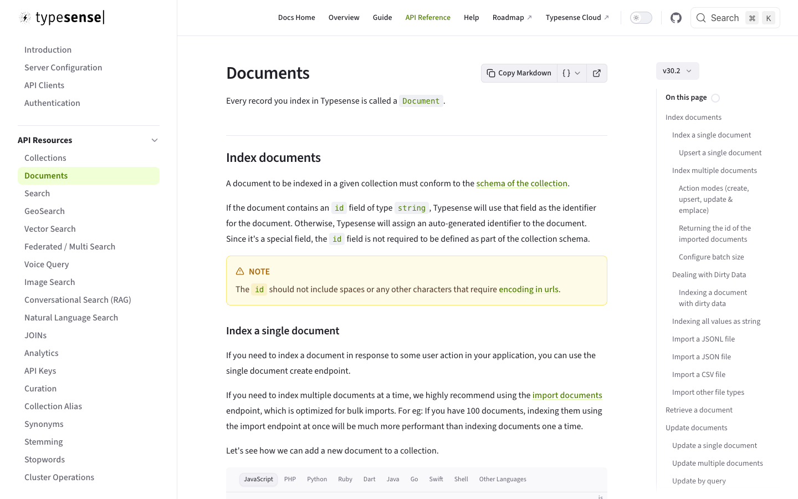 | 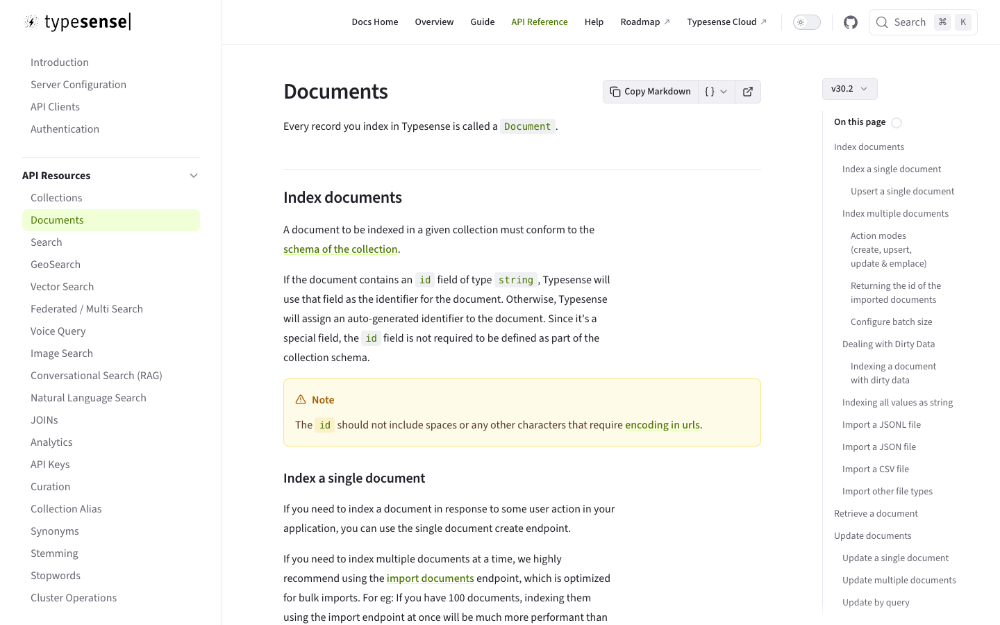 |

- `a7a03d39` In the search button at the top right, "Search" and the key caps switch from the system font to Source Sans 3. The button is 5px narrower, and the nav links to its left move 5px right.
- `de20e790` In the same search button, the "Search" label and the magnifier turn a lighter blue-gray (#4d4d4d to #636370).
- `819cc8d7` The "v30.2" pill at the top of the right column gains a thin gray border.
- `84032a0f` In the middle column, body paragraphs stop at 480px instead of running the full 688px. The Note callout still spans the whole column.
- `085e9425` *Not visible in this pair.*
- `5de0bfd3` In the left sidebar, page links such as "Collections" and "Search" are regular weight instead of medium. They look lighter and a little shorter.
- `8da4e8c6` In the right column "On this page" list, "Action modes (create, upsert, update & emplace)" no longer leaves "emplace)" alone on its last line. It wraps into three even lines.

> Other differences in this frame come from shas shown in other crops. The Note callout title and its looser lines come from e69af439 and af36c9ea (see callouts). Inline code and links are a shade darker from 886ec9e6 (see L2 table-chip). The tab strip at the bottom edge comes from 11126d9b. Nothing unexplained.

#### Top of the page, whole viewport (dark)

| Before | After |
|---|---|
| 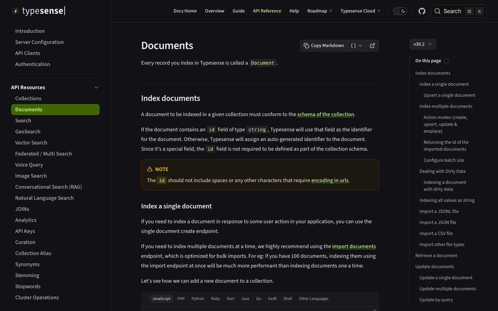 | 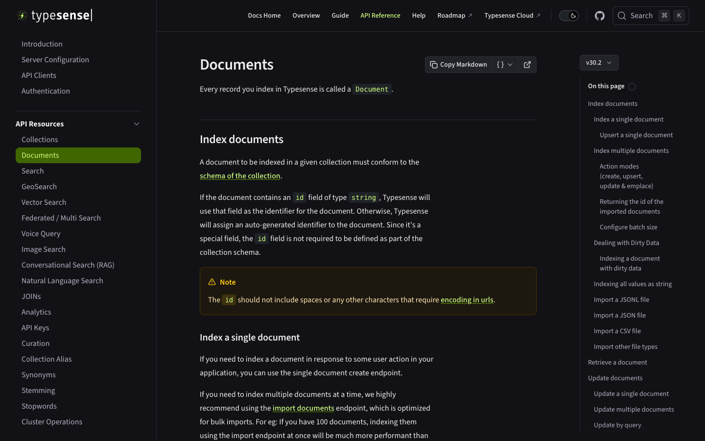 |

- `a7a03d39` In the search button at the top right, "Search" and the key caps switch from the system font to Source Sans 3. The button is 5px narrower, and the nav links to its left move 5px right.
- `de20e790` In the same search button, the "Search" label drops from near-white to a dimmer gray (#f9f9f9 to #b2b2c3).
- `819cc8d7` The "v30.2" pill at the top of the right column gains a thin gray border, easier to see than in light.
- `84032a0f` In the middle column, body paragraphs stop at 480px instead of running the full 688px. The Note callout still spans the whole column.
- `085e9425` *Not visible in this pair.*
- `5de0bfd3` In the left sidebar, page links such as "Collections" and "Search" are regular weight instead of medium. They look lighter and a little shorter.
- `8da4e8c6` In the right column "On this page" list, "Action modes (create, upsert, update & emplace)" no longer leaves "emplace)" alone on its last line. It wraps into three even lines.

> Other differences in this frame come from shas shown in other crops. The Note callout title and its looser lines come from e69af439 and af36c9ea (see callouts). The tab strip at the bottom edge comes from 11126d9b. Nothing unexplained.

#### First code tab group (light)

| Before | After |
|---|---|
| 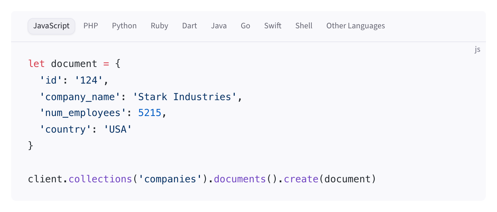 | 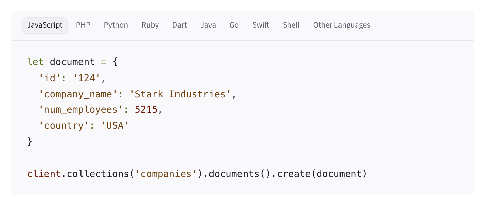 |

- `c425dce1` In the top-right corner of the code panel, the small gray "js" label is gone.
- `dc72f6b4` *Not visible in this pair.* The top corners of the tab strip round at 8px instead of 6px.
- `11126d9b` In the tab strip, the "JavaScript" label now starts at the same left edge as "let" in the code below. On base it sits 8px further right. The selected pill now hangs into the left gutter.

> Token colours in the code also change, from 5e30f0af and e3d83063 (see L2 code). The narrower edge fades only show when the strip scrolls, and this strip does not overflow at 1440.

#### Zoom on the tab strip top-left corner (light)

| Before | After |
|---|---|
| 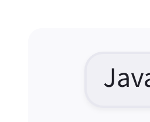 | 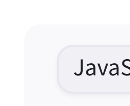 |

- `dc72f6b4` The top-left corner of the gray strip curves over a wider arc on HEAD (8px radius) than on base (6px).

> Extra framing at deviceScaleFactor 4 because the 2px change is hard to judge in the tabs pair. The pill starting further left comes from 11126d9b.

#### First JSON-only group (light)

| Before | After |
|---|---|
| 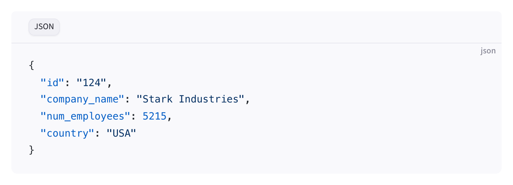 | 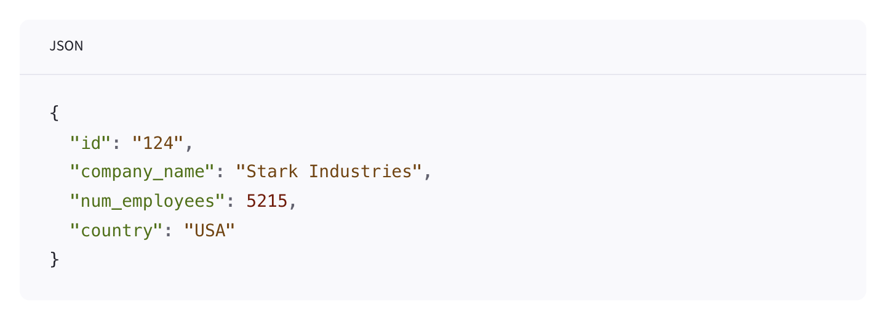 |

- `ea15f32d` At the top left of the panel, "JSON" is plain text on HEAD with no bordered gray pill behind it.

> The "json" corner label also goes (c425dce1), the "JSON" label lines up with the code (11126d9b) and token colours change (5e30f0af).

#### Warning plus tip pair (light)

| Before | After |
|---|---|
| 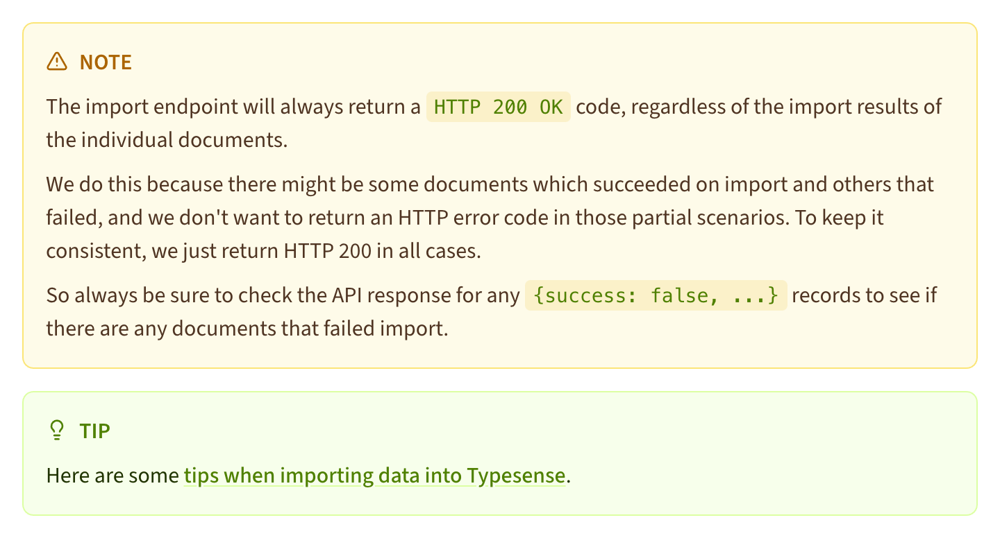 | 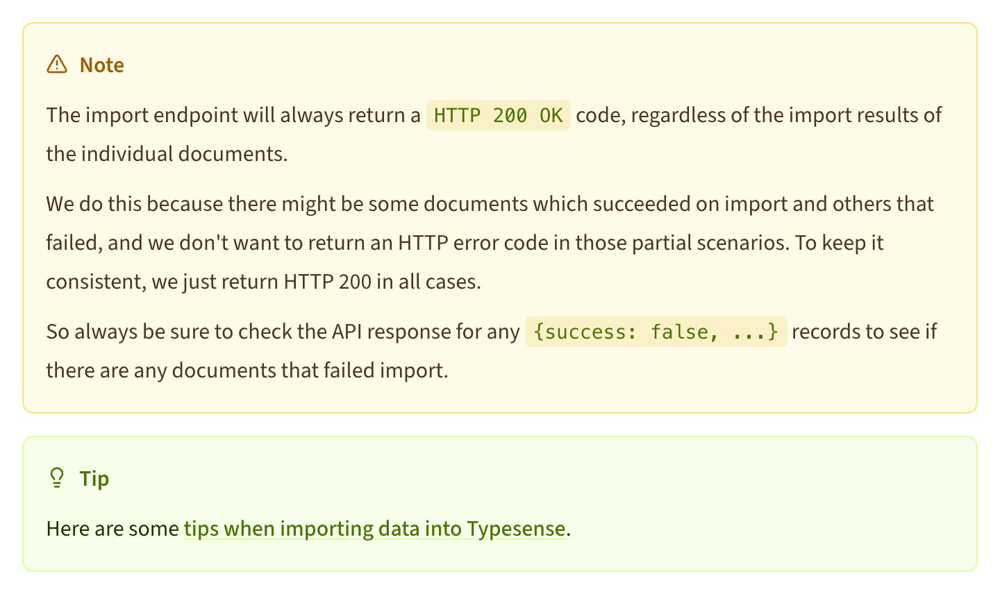 |

- `af36c9ea` Inside the yellow Note box, lines sit 28px apart instead of 24px. The box grows from 250px to 282px tall.
- `6a85ca5a` In the green box at the bottom, the title reads "Tip" instead of "TIP".
- `e69af439` In the yellow box at the top, the title reads "Note" instead of "NOTE".

#### Keyboard focus on the Copy Markdown button (light)

| Before | After |
|---|---|
| 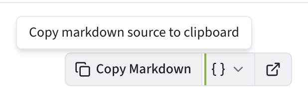 | 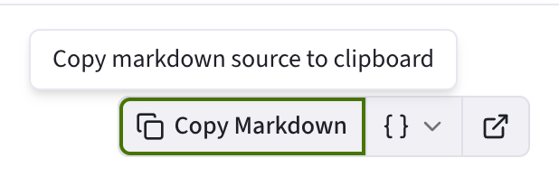 |

- `ec87f0ff` On the Copy Markdown button, base shows only a green bar on its right seam. HEAD draws a complete ring inside the button.
- `ade9117d` The ring on the Copy Markdown button goes from pale lime (#8bb34d) to dark green.
- `886ec9e6` The HEAD ring's dark green (#487500) is the darker brand 11 this commit sets. This pair shows it together with ade9117d and cannot isolate the one-step change.

#### Keyboard focus on the "v30.2" version trigger (light)

| Before | After |
|---|---|
| 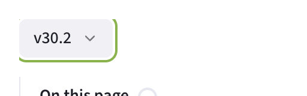 | 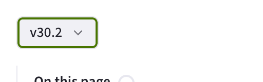 |

- `ec87f0ff` On the "v30.2" trigger, base shows the ring only along the right and bottom edges. HEAD draws a complete ring inside the pill.
- `ade9117d` The ring on the "v30.2" version trigger goes from pale lime (#8bb34d) to dark green.
- `886ec9e6` The HEAD ring's dark green (#487500) is the darker brand 11 this commit sets. This pair shows it together with ade9117d and cannot isolate the one-step change.

> The trigger also gains a thin border from 819cc8d7.

#### Keyboard focus on the Copy Markdown button (dark)

| Before | After |
|---|---|
| 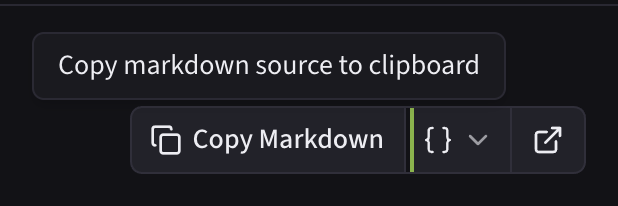 | 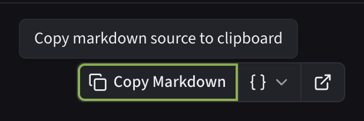 |

- `ec87f0ff` On the Copy Markdown button, base shows only a green bar on its right seam. HEAD draws a complete ring inside the button.
- `ade9117d` No colour change is expected in dark. The ring on the Copy Markdown button is the same lime (#8bb34d) on both.
- `886ec9e6` No colour change is expected in dark. The ring colour matches on both.

> The tooltip above the button sits on a lighter gray on HEAD (#1a1a1f to #23232a). That comes from 5bfe7432 (see L2 listbox).

#### Keyboard focus on the "v30.2" version trigger (dark)

| Before | After |
|---|---|
| 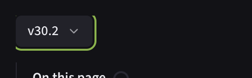 | 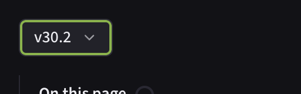 |

- `ec87f0ff` On the "v30.2" trigger, base shows the ring only along the right and bottom edges. HEAD draws a complete ring inside the pill.
- `ade9117d` No colour change is expected in dark. The ring on the "v30.2" version trigger is the same lime (#8bb34d) on both.
- `886ec9e6` No colour change is expected in dark. The ring colour matches on both.

> The trigger also gains a thin border from 819cc8d7.

### API reference tables, code and popups

`/docs/30.2/api/search.html` at 1280x800

#### First parameter table, heading plus header and two rows (light)

| Before | After |
|---|---|
| 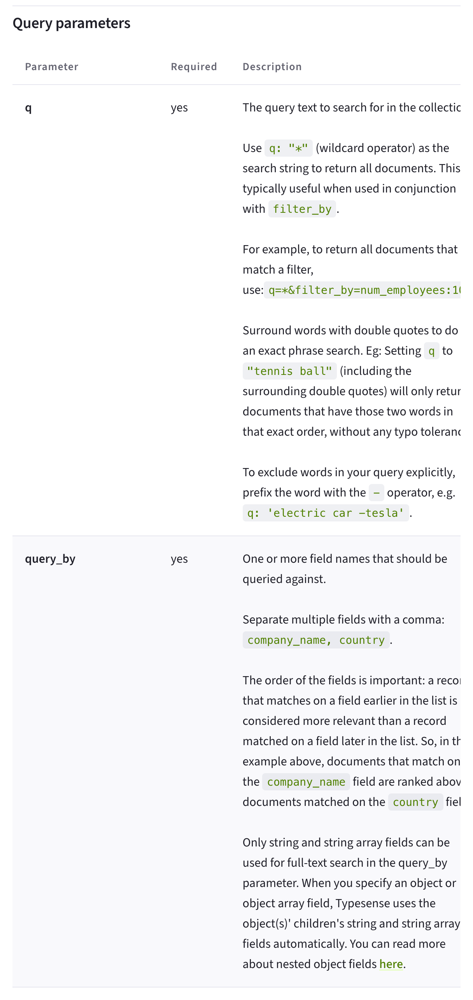 | 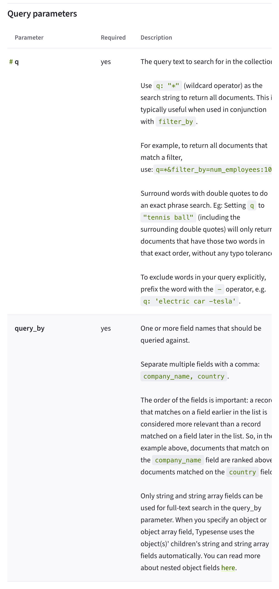 |

- `886ec9e6` *Not visible in this pair.* Green inline code such as `q: "*"` and `company_name, country` is one step darker (#4f8000 to #497500).
- `39ab66e7` In the header row, "Parameter", "Required" and "Description" lose their wide letter-spacing and sit tighter.
- `f78d766d` The gap between the "Query parameters" heading and the table shrinks from 20px to 16px. The header row sits 4px higher on HEAD.
- `e1d57f93` Left of "q" in the first row, HEAD shows a small green # link while the row is hovered. Base shows the name alone.

> The mouse rests on the q row's "yes" cell because the # only shows on hover on desktop. The viewport is 1280x1400 instead of 1280x800 so the heading and two 580px-tall rows fit. The width and layout are unchanged. The Description column starts about 5px further left on HEAD because the tighter "Required" header (39ab66e7) narrows that column.

#### Zoom on one inline code chip in the table (light)

| Before | After |
|---|---|
|  | 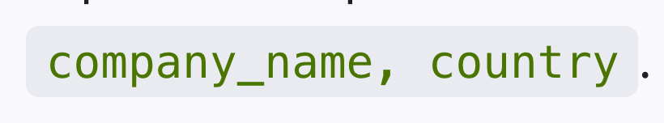 |

- `886ec9e6` The green "company_name, country" text is a touch deeper and more olive on HEAD.

> Subtle. Extra framing at deviceScaleFactor 4 of the chip in the query_by row. Computed colour goes from #4f8000 to #497500. A contrast gate is the firmer check.

#### First code group on its JavaScript tab (light)

| Before | After |
|---|---|
| 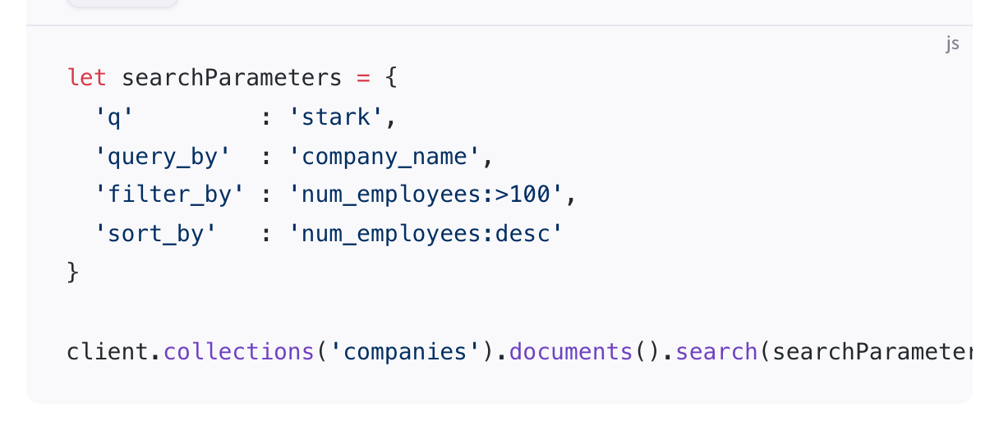 | 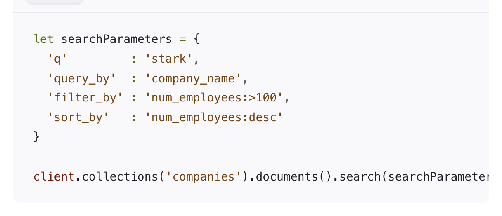 |

- `5e30f0af` Across the code panel, GitHub's red, navy and purple tokens become the site palette. "let" turns green, strings brown-amber, "client" dark red and the method names plain gray.
- `e3d83063` On HEAD the three token colours differ in lightness. Green "let" is the lightest, the amber strings sit in the middle and dark red "client" is the darkest.

> The gray "js" label in the top-right corner also goes (c425dce1).

#### First code group on its JavaScript tab (dark)

| Before | After |
|---|---|
| 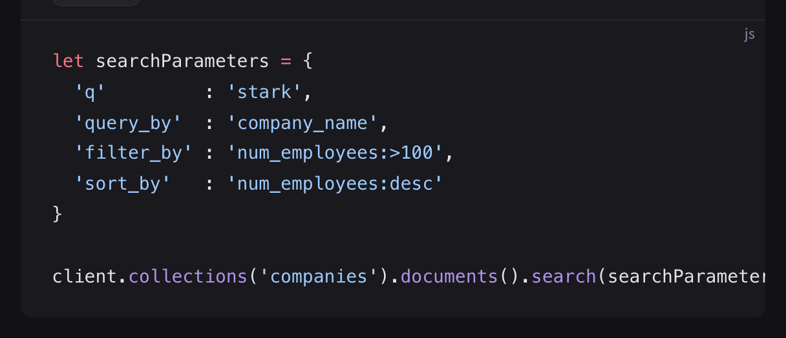 | 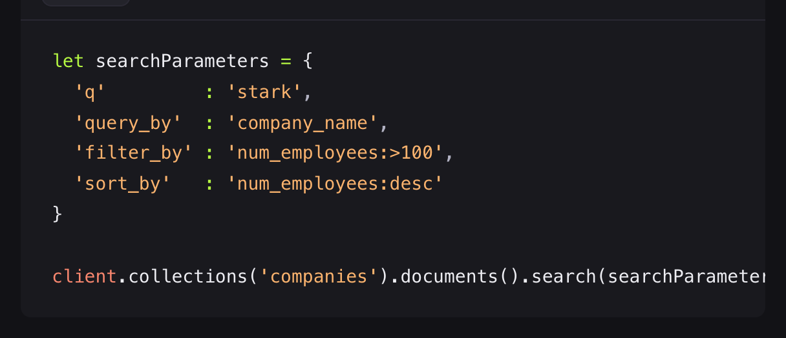 |

- `5e30f0af` Across the code panel, GitHub's pink, light blue and purple tokens become lime keywords, amber strings, a tomato "client" and gray method names.
- `e3d83063` The lime, amber and tomato tokens sit at clearly different brightness on HEAD, lime brightest and tomato darkest.

> The gray "js" label in the top-right corner also goes (c425dce1).

#### Selected text in the first code panel (dark)

| Before | After |
|---|---|
| 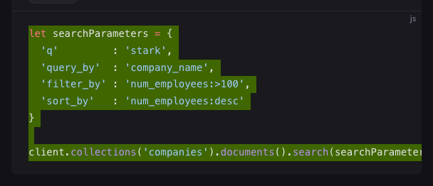 | 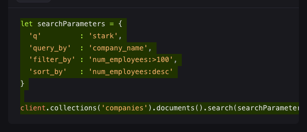 |

- `78e0b917` The selection fill behind the code goes from a bright mid green to a much darker green, and the tokens on it read more clearly.

> Token colours under the selection also change (5e30f0af) and the "js" label goes (c425dce1).

#### Aside version list open, one row keyboard-focused (dark)

| Before | After |
|---|---|
| 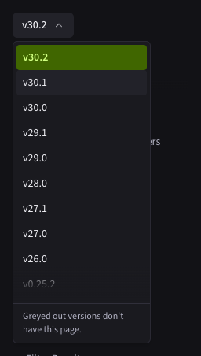 | 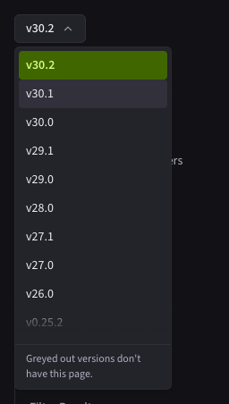 |

- `5bfe7432` The open version list is a lighter gray than the page on HEAD (#1a1a1f to #23232a). The focused "v30.1" row is lighter still (#222229 to #31303b) and stands out more.
- `66d59344` *Not visible in this pair.*
- `17966f88` *Not visible in this pair.*

> The trigger above the list also gains a thin border (819cc8d7).

#### Search modal after typing 'vector search' (light)

| Before | After |
|---|---|
| 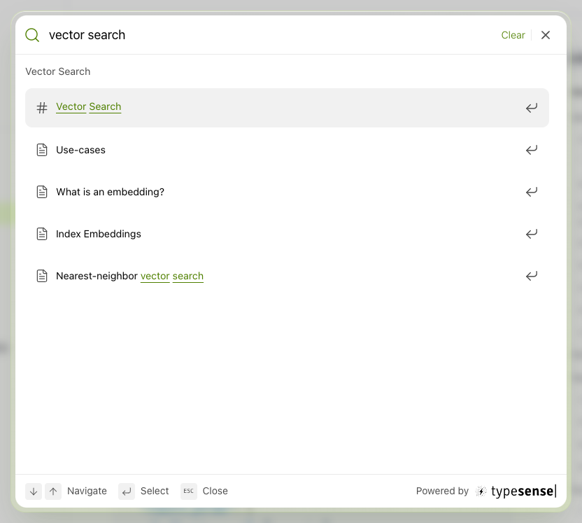 | 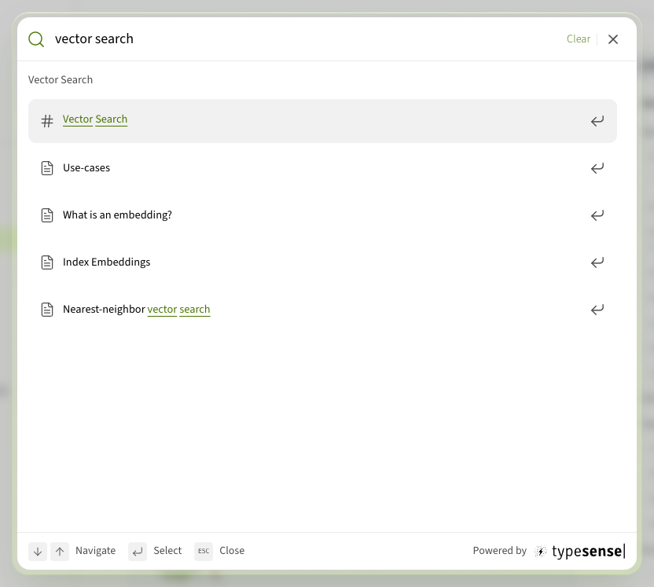 |

- `a7a03d39` Across the modal, the typed query, the hit titles and the footer labels ("Navigate", "Select", "Close") switch from the system font to the narrower Source Sans 3.
- `6ad33ed6` *Not visible in this pair.* The underlined matches ("Vector Search", "vector search") and "Clear" are one step darker green.

> One live query per build, entered with a single fill so each build sent one request. Both builds returned the same five hits.

#### Zoom on the hits in the search modal (light)

| Before | After |
|---|---|
| 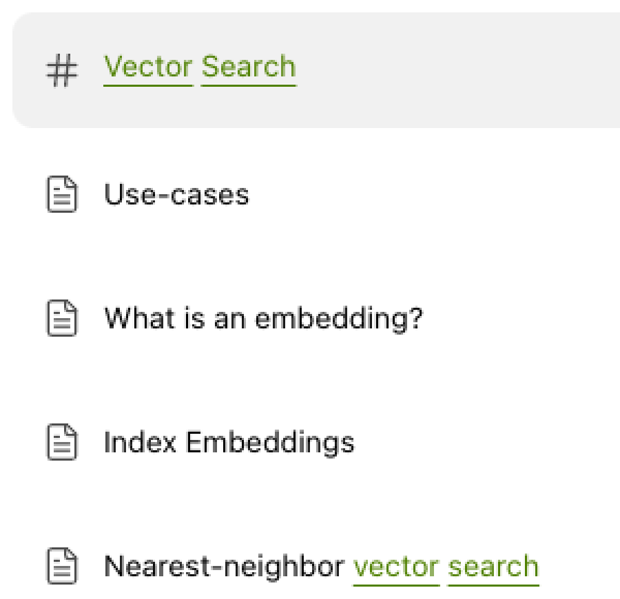 | 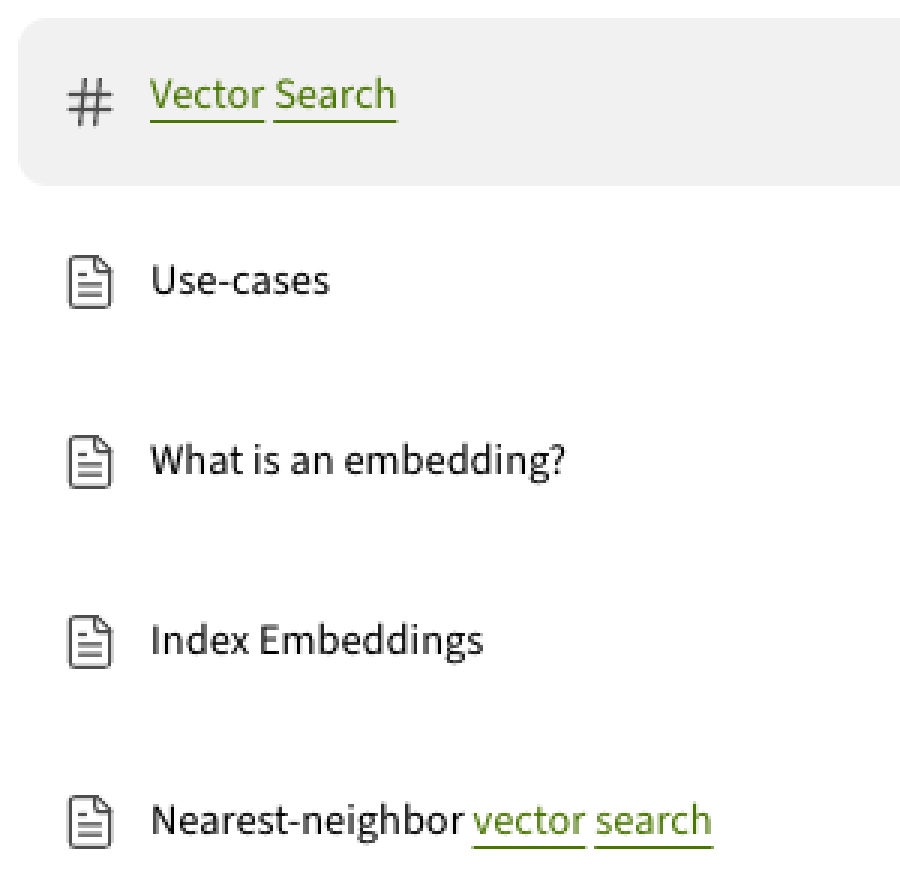 |

- `6ad33ed6` The green match text and underlines in the selected "Vector Search" hit and the last row read slightly deeper on HEAD.

> Subtle. This is a 3x pixel zoom of the search-modal captures, so no extra queries ran. The thinner Source Sans 3 strokes from a7a03d39 also change how dark the green reads.

#### On this page outline at scrollY 0 (light)

| Before | After |
|---|---|
| 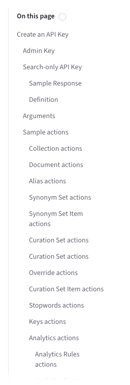 | 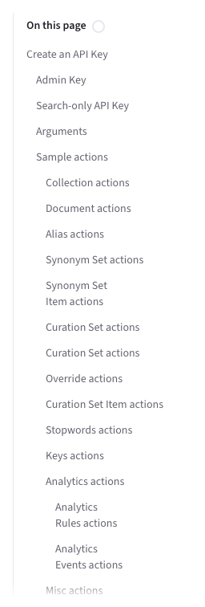 |

- `bb6a4814` In the right column list, "Sample Response" and "Definition" no longer appear under "Search-only API Key". Everything below moves up two rows.

> Labels such as "Synonym Set Item actions" and "Analytics Rules actions" also wrap differently, from 8da4e8c6. The list is taller than the 900px viewport on both builds, so outline-full shows all of it.

#### Whole On this page outline (light)

| Before | After |
|---|---|
| 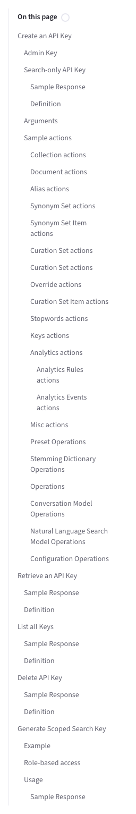 | 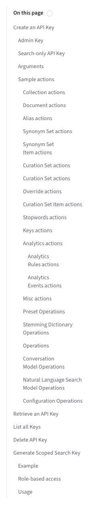 |

- `bb6a4814` Down the whole list, HEAD drops every "Sample Response" and "Definition" row (42 rows to 33) and ends about 290px shorter.

> Extra framing with a 1440x1720 viewport so the full outline fits on both builds.

### Copy menu

`/docs/30.2/api/analytics-query-suggestions.html` at 1280x800

#### Language popover open, mouse moved away (light)

| Before | After |
|---|---|
| 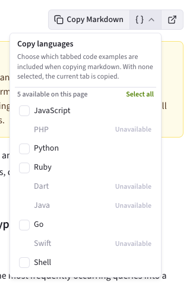 | 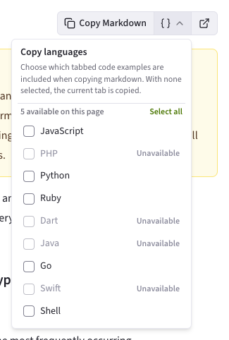 |

- `a8463db1` In the checkbox column, every box has a solid gray border on HEAD. The PHP, Dart, Java and Swift rows gain a half-opacity box where base shows none.
- `aa3eebef` At the right edge, the four "Unavailable" notes are a darker, readable gray (#babacb to #8c8c9d).
- `2547430e` *Not visible in this pair.*

> The page text behind the menu wraps earlier on HEAD because of the prose cap (84032a0f).

#### Language popover open, mouse moved away (dark)

| Before | After |
|---|---|
| 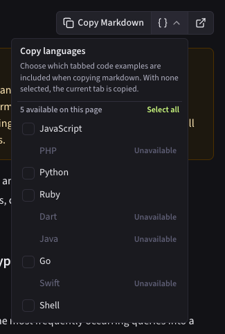 | 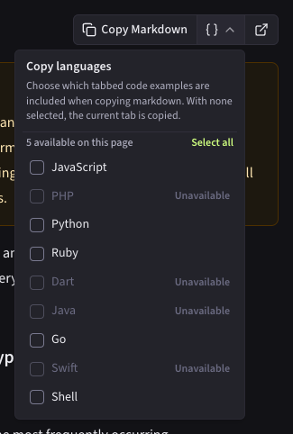 |

- `a8463db1` In the checkbox column, the boxes gain a clear gray border on HEAD. The unavailable rows gain a faded box where base shows none.
- `aa3eebef` *Not visible in this pair.* The "Unavailable" notes step from #5e5e75 to #6b6b82.
- `2547430e` *Not visible in this pair.*

> The menu surface is lighter on HEAD (#1a1a1f to #23232a), from 5bfe7432. The page text behind it wraps earlier because of the prose cap (84032a0f).

#### Zoom on the first four language rows (dark)

| Before | After |
|---|---|
| 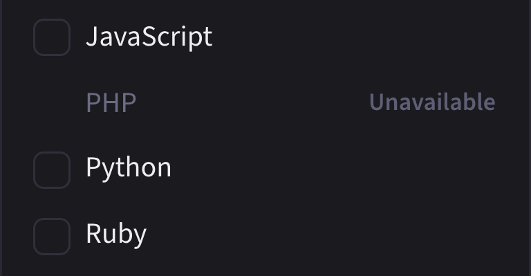 | 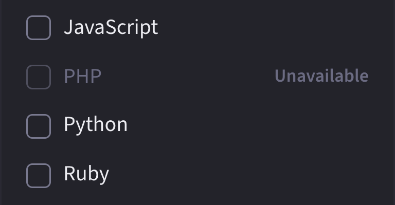 |

- `a8463db1` Left of each language, the box outlines are clearly drawn on HEAD and faint on base. PHP gains a faded box.
- `aa3eebef` *Not visible in this pair.* The "Unavailable" note beside PHP.

> Extra framing at deviceScaleFactor 3. The lighter surface comes from 5bfe7432.

### Tablet nav menu

`/docs/30.2/api/search.html` at 768x1024

#### Extra navigation menu open, mouse on the page body (dark)

| Before | After |
|---|---|
| 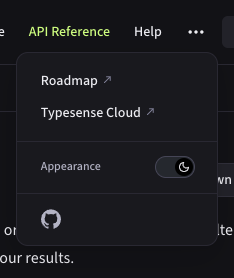 | 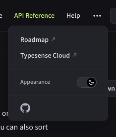 |

- `fe94d5f1` The "•••" menu panel is a slightly lighter gray on HEAD (#19191e to #222229) and lifts off the page. Border and contents match.

> Setup differs in one step. Base opens this menu on hover, so after a real click the menu shuts once the mouse leaves (f2ad9046 made HEAD open on click only). The script clicks on both builds and moves the mouse to the page body, then reopens base with a scripted click. HEAD stayed open on its own. Page text behind the panel wraps differently because of the prose cap (84032a0f).

### Guide page on a laptop

`/docs/guide/install-typesense.html` at 1440x900

#### First screen of Install Typesense (light)

| Before | After |
|---|---|
| 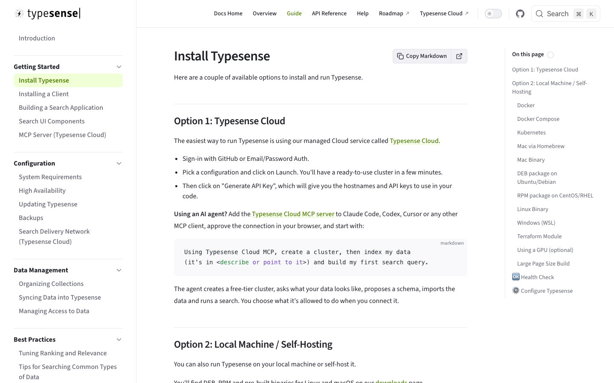 | 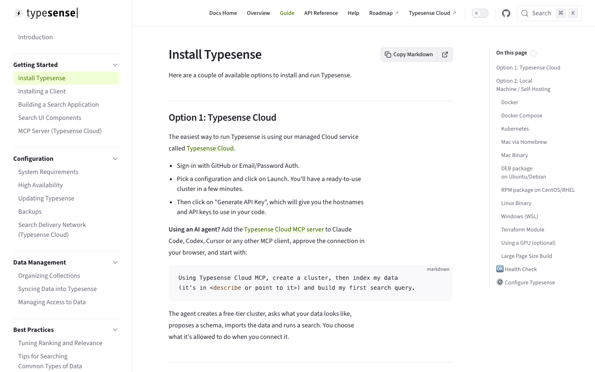 |

- `8da4e8c6` In the On this page outline 'Option 2: Local Machine / Self-Hosting' and 'DEB package on Ubuntu/Debian' now break near the middle, and in the sidebar's last row 'Tips for Searching Common Types of Data' no longer leaves 'of Data' alone.
- `5de0bfd3` Sidebar page links such as 'Installing a Client' are a little thinner and narrower on HEAD, while group titles like 'Getting Started' stay bold.
- `085e9425` Body paragraphs in the main column wrap at 480px on HEAD while the markdown code block below them keeps the full column width.

> Also visible and explained by commits outside this crop. Code token colours change (5e30f0af, e3d83063), the 'markdown' label is darker (35505491), the active 'Install Typesense' is no longer semibold (84ecbfdd), link green is a step darker (886ec9e6) and the top nav links sit 5px further right because the search button is 5px narrower in the site font (a7a03d39, measured 162 to 157px).

#### Sidebar guide groups (light)

| Before | After |
|---|---|
| 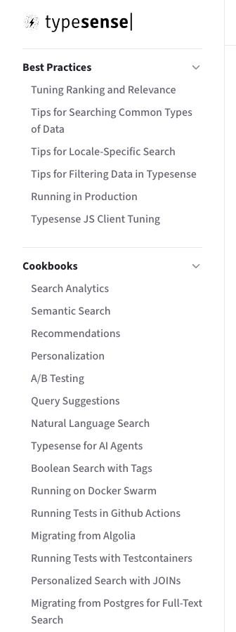 |  |

- `d24ce632` Below Best Practices, HEAD shows Cookbooks, Walk-Throughs and Reference Implementations as closed rows with right-pointing chevrons and Teams open between them, while base opens Cookbooks and its links fill the rest of the sidebar.

> Framed with Best Practices at the top of the sidebar rather than Cookbooks, because the nav bar covers the first rows and hid the Cookbooks title on base. HEAD's sidebar reaches the end of its scroll and sits 15px lower.

#### macOS compatibility warning (light)

| Before | After |
|---|---|
|  |  |

- `ff3818a2` The amber title 'Compatibility with macOS' is a shade browner on HEAD, a faint change that is easiest to catch by flicking between the two images.
- `af36c9ea` The body lines inside the callout sit 28px apart on HEAD instead of 24px, which makes the box 16px taller.

> deviceScaleFactor 2. The title keeps its casing on both builds.

#### Code block language label (light)

| Before | After |
|---|---|
|  |  |

- `35505491` The small 'markdown' label in the top-right corner of the code block is a darker grey on HEAD.

> The code token colours also change, from the site palette commits 5e30f0af and e3d83063, and HEAD no longer colours 'or point to it'. deviceScaleFactor 2, mouse off the block.

#### Code block language label (dark)

| Before | After |
|---|---|
|  |  |

- `35505491` The small 'markdown' label in the top-right corner of the code block is a lighter grey on HEAD.

> The code token colours and the plain code text also change, from the site palette commits 5e30f0af and e3d83063. deviceScaleFactor 2, mouse off the block.

#### Sidebar around the current page (light)

| Before | After |
|---|---|
|  |  |

- `84ecbfdd` The highlighted 'AI Search with LangChain & Chainlit' row fits on one line in regular weight on HEAD, where base sets it semibold over two lines and pushes the Teams group 24px lower.
- `5de0bfd3` The other links, like 'Search Bar in Qwik.js', are a little thinner on HEAD.

> Both crops are anchored on the active row after a 1s wait. Reference Implementations is collapsed on HEAD (d24ce632) and 'Role-Based Access Control for Admin Dashboard' breaks differently (8da4e8c6).

#### Sidebar scrollbar (light)

| Before | After |
|---|---|
|  |  |

- `7dabec76` Along the right edge of the sidebar HEAD draws a grey scrollbar track and thumb, and base has none.

> Captured in a browser launched without Chromium's --hide-scrollbars flag, which draws a classic scrollbar. Overlay-scrollbar systems such as default macOS look the same on both builds.

### Phone

`/docs/30.2/api/search.html` at 390x844 phone (isMobile, hasTouch)

#### Breadcrumb row (light)

| Before | After |
|---|---|
|  |  |

- `e654bb5b` The breadcrumb under the logo starts with 'v30.2' and a small chevron on HEAD, ahead of 'API Reference > Search'.
- `fc63b9ee` *Not visible in this pair.*

> The search icon in the top bar is a bluer grey on HEAD, from de20e790 (search button tinted with the site greys, icon #4d4d4d to #636370).

#### Copy languages popover (light)

| Before | After |
|---|---|
|  |  |

- `dc9ac5ca` The popover's left edge lines up with the Copy Markdown button group on HEAD, 8px further right than on base where it overhangs the group.

> The checkbox borders are darker on HEAD, from a8463db1 (visible checkbox edge).

#### First three parameter rows (light)

| Before | After |
|---|---|
|  |  |

- `e1d57f93` Each parameter name ('--config', '--api-key', '--data-dir') has a muted # in front of it on HEAD and sits about 20px further right.
- `2dc5f5f0` *Not visible in this pair.*

#### Pinned section bar (light)

| Before | After |
|---|---|
|  |  |

- `032fc436` The pinned bar under the breadcrumb reads 'Step 8: Implement paginated sy…' on one line on HEAD, where base wraps the full title over two lines and covers more of the page.

> Code token colours differ, from 5e30f0af.

### Docs home and old versions

`/docs/` at 1280x800

#### Docs home content (light)

| Before | After |
|---|---|
|  |  |

- `4fc72719` Under the welcome line HEAD adds 'New to Typesense? Start with the Quick Start in the Guide', and at the bottom the 31 version links wrap in four rows instead of a long bulleted column.
- `085e9425` Paragraphs stop at 480px on HEAD, for example under 'Help us improve the docs', while the table and the Tip callout keep the full width.

> No cut. The element is 2187px tall on base and 1459px on HEAD at 1x. Other differences come from commits outside this crop. 'TIP' reads 'Tip' (6a85ca5a), the callout lines are looser (af36c9ea), table headers lose their letter-spacing (39ab66e7), table spacing changes (f78d766d) and link green is a step darker (886ec9e6).

#### Old-version home cards (light)

| Before | After |
|---|---|
|  |  |

- `eee80b20` The corners of the What's New, Guide and API Reference cards are rounded on HEAD and square on base.

### Not found page

`/docs/nope.html` at 1280x800

#### 404 message (light)

| Before | After |
|---|---|
|  |  |

- `f93c0c38` At the end of the sentence under 'Page not found', 'search the docs' is lime green, medium weight and underlined on HEAD, where base shows it as plain grey text.

> Title search stubbed to empty results on both builds. The '404' label is a step darker green on HEAD (886ec9e6).

#### 404 message (dark)

| Before | After |
|---|---|
|  |  |

- `f93c0c38` At the end of the sentence under 'Page not found', 'search the docs' is bright lime, medium weight and underlined on HEAD, where base shows it as plain grey text.

> Title search stubbed to empty results on both builds.

#### Suggestions with keyboard focus (light)

| Before | After |
|---|---|
|  |  |

- `264fbc07` Around the first suggestion 'Collection Alias' HEAD draws the blue focus outline on all four sides, where base shows only a blue line along its bottom edge.
- `35505491` The 'WERE YOU LOOKING FOR?' heading and the grey URLs under each title are a darker grey on HEAD.

> Live suggestions, one load per build, 2 live queries in total. Both builds returned the same four results. Focus reached the first suggestion by focusing the API Reference button and pressing Tab.

### Before JavaScript runs

`/docs/30.2/api/search.html` at various, JavaScript off

#### Search page first screen on a phone (light)

| Before | After |
|---|---|
|  |  |

- `8c75edf5` Below the intro paragraph HEAD shows the code tab strip and the JavaScript example, where base goes straight to 'Sample Response' with no code at all.
- `6ea64666` At the right end of the bar under the logo base reads 'Return to top' and HEAD reads 'On this page'.

> Whole viewport at scrollY 0, which already holds the first code group. Also in the first paint on HEAD are the v30.2 breadcrumb item (e654bb5b) and the search icon (780722ac).

#### Search page shell on a laptop (light)

| Before | After |
|---|---|
|  |  |

- `04f199ee` In the sidebar under API Resources, 'Search' sits on the lime pill on HEAD and nothing marks it on base.
- `cebd9e1b` *Not visible in this pair.* No still shows this one. The nav bar's container changes size, but the logo and the right edge of the bar sit in the same place on both builds.

> The nav links sit further left on HEAD because the search button is now in the first paint (780722ac), not because of cebd9e1b. Also visible are the code tabs (8c75edf5), the 480px prose cap and the thinner sidebar links (5de0bfd3).

#### Docs home top on a phone (light)

| Before | After |
|---|---|
|  |  |

- `103b1f77` Under the top bar HEAD has the 'On this page' bar, and base has no bar, which leaves its content 48px higher.
- `4d384472` The same bar is what stops the content dropping 48px when the page wakes up, compare where 'Typesense Documentation' starts.
- `6ea64666` *Not visible in this pair.* Base has no bar on this page at all, so the 'Return to top' to 'On this page' swap doesn't show here.

> The search icon (780722ac) and the Quick Start line (4fc72719) also differ.

## Watch

Each clip runs the same steps on both builds. A badge in the corner shows the keys pressed. Open a clip to play it, or use the interactive version to play both in step.

### Code tabs from the keyboard

`/docs/30.2/api/documents.html` at 1280x800 (phone clip 390x844, isMobile, hasTouch). Commits `5ed71446`, `ba82008a`, `eb4869bf`, `9f5824f1`, `b38e1318`, `9a961159`.

- [before](walks/W1/base.webm) · [after](walks/W1/head.webm)
- phone [before](walks/W1/base-phone.webm) · [after](walks/W1/head-phone.webm)

1. Scroll to 'Index a single document' and click in the paragraph 'Let's see how we can add a new document to a collection.'
2. Press Tab once
3. Press ArrowRight twice, then ArrowLeft once
4. Click 'Go' in the same strip with the mouse
5. Scroll to the first 'Sample Response' and drag from that line down into the JSON code below it
6. Phone clip: at 390px scroll the first tab strip sideways so JavaScript sits half under the left edge fade, click the paragraph above it, press Tab, then ArrowLeft

**After.** Tab lands on JavaScript with a lime inset ring. Each arrow selects the next tab at once (PHP, Python, then back to PHP after ArrowLeft) and every group on the page switches while the strip stays put. Clicking Go glides the pill. The drag highlights 'Sample Response' and the code but not the 'JSON' label. Phone: Tab scrolls the strip so JavaScript sits fully clear of the fade with its ring, and ArrowLeft wraps to 'Other Languages', fully clear of the right fade.

**Before.** Tab skips the strip and rings the hidden code copy button. The arrows change nothing. Go still works with the mouse. The drag highlights the 'JSON' label too. Phone: Tab focuses the whole strip as a scroll box, and ArrowLeft only scrolls it back.

> Checked from frame sheets of all four clips. Not visible on video, so left to gates: ba82008a (lone tabs are not a Tab stop, gate tabs-lone-tab-not-a-stop), eb4869bf (arrows step from the focused tab, gate tabs-arrow-steps-from-focused-tab) and 9f5824f1 (the lone label shows no pointer and a click doesn't save 'JSON', gate tabs-lone-tab-unclickable). Headless video draws no mouse cursor. The drag highlight is small in the clip, pause near the end to see it.

### Image zoom from the keyboard

`/docs/guide/high-availability.html` at 1280x800. Commits `db6f668e`, `529af28e`, `0e6dbad4`, `7d6f6435`.

- [before](walks/W2/base.webm) · [after](walks/W2/head.webm)

1. Click in the paragraph just above the 'Typesense Cloud HA Hostnames' screenshot ('When you flip the setting ON...')
2. Press Tab
3. Press Enter
4. Press Tab
5. Click the screenshot with the mouse and wait for the zoom to finish
6. Press Tab

**After.** Tab lands on the screenshot. Enter opens the zoom and Tab closes it with focus back on the screenshot. After a mouse zoom, Tab also closes it and focus lands back on the screenshot. The page never moves.

**Before.** Tab skips the screenshot and lands on the 'Client Configuration' link in the note further down, and Enter follows that link to its section. After a mouse zoom, Tab moves focus to that link behind the overlay. The page scrolls to it, which closes the zoom.

> Checked from frame sheets. The screenshot's focus ring is Chrome's default 1px auto outline, not the site's lime ring, and it is hard to see against the image's own blue frame. The clip shows focus by what Enter and Tab do, not by a ring. 0e6dbad4 (clicking the zoomed image shut returns focus) has no visible effect and is covered by gate zoom-click-close-returns-focus.

### Copy menu and version picker from the keyboard

`/docs/30.2/api/collections.html` at 1440x900. Commits `2547430e`, `ba4383af`, `547c3e8d`.

- [before](walks/W3/base.webm) · [after](walks/W3/head.webm)

1. Press Tab until the braces button next to Copy Markdown is focused, then press Enter
2. Press Tab to reach the first language (JavaScript) and press Space
3. Press Escape
4. Press Tab until the v30.2 version picker in the right column is focused, then press Enter
5. Type 0.23 quickly
6. Press End
7. Press ArrowUp
8. Press Escape

**After.** Enter opens the menu on Select all. Tab rings the JavaScript checkbox and Space ticks it. In the version list, typing 0.23 moves the highlight to v0.23.1, End moves it to the last row v0.11.2, and ArrowUp to v0.12.0. Escape closes the list with focus on the picker.

**Before.** The copy menu looks and toggles the same, with an outer offset ring on the row. Typing 0.23 leaves the highlight on v30.2. End drops the highlight and ArrowUp does nothing. Escape still closes the list.

> Checked from frame sheets. 2547430e changes what a screen reader hears (a named checkbox with its ticked state), so its menu half looks almost the same on both builds. The gate copy-languages-are-checkboxes shows the difference. Ticking JavaScript also sets it as the shown tab, which is existing behaviour.

### Skip link and landing focus

`/docs/30.2/api/search.html` at 1440x900. Commits `64ec5980`, `08c5cbf5`, `d74ea978`.

- [before](walks/W4/base.webm) · [after](walks/W4/head.webm)

1. Load /docs/30.2/api/search.html at 1440x900 and press Tab once. "Skip to content" appears top left.
2. Press Enter, then Tab.
3. Move focus to the 'this table' link in the split_join_tokens row of the Typo-Tolerance parameters table (it points at collections.html#schema-parameters) and press Enter.
4. When collections.html has landed on 'Schema parameters', press Tab.
5. Back on search.html, scroll until the 'scoped API key' link in the Caching parameters table sits just under the pinned bars. Click the text of the 'Filter Results' heading just below that table.
6. Press Shift+Tab twice and watch each focus ring.

**After.** After the skip, Tab lands on the title's # anchor in the article. After the cross-page link, Tab moves to the next control at 'Schema parameters' and the page stays put. The first Shift+Tab scrolls 'scoped API key' out from under the pinned bars and its ring shows.

**Before.** After the skip, Tab lands on the v30.2 version picker in the right column. After the cross-page link, Tab focuses 'Skip to content' and the page jumps to the top. The first Shift+Tab puts focus on 'scoped API key' while it sits hidden under the pinned 'Caching parameters' bar, so no ring shows and the page doesn't move.

> Checked frames. After the skip HEAD rings the title # and base rings v30.2 in the aside. After the cross-page landing HEAD rings the Schema parameters # in place and base shows Skip to content at the top. On the first Shift+Tab HEAD scrolls scoped API key into view with its ring, base shows no ring because the link sits under the Caching parameters bar. The video runs about 0.5 to 1s behind the keys badge.

### Phone menu, sidebar drawer and outline dropdown

`/docs/30.2/api/search.html` at 390x844 touch. Commits `6c40f66a`, `f01a81ed`, `4bcb92ad`.

- [before](walks/W5/base.webm) · [after](walks/W5/head.webm)

1. Load /docs/30.2/api/search.html at 390x844 (touch) and tap the hamburger at the top right.
2. Press Tab 15 times.
3. Press Escape. If the menu is still open, tap the hamburger again to close it.
4. Press Tab 4 times.
5. Move focus to 'On this page' in the bar under the nav and press Enter, then Tab into the list.
6. Press Escape, then Tab once.

**After.** Tab cycles through the nav bar and menu only and is back on 'Docs Home' after 15. Escape closes the menu and focus sits on the hamburger. The next four Tabs go Menu, v30.2, On this page, then the article. Escape in the outline list closes it with focus back on 'On this page', and Tab carries on into the article.

**Before.** From the 11th Tab focus leaves the menu for 'Menu', 'On this page' and sidebar links hidden behind the overlay, so no ring shows. Escape does nothing. With the menu closed, Tabs 3 and 4 land on sidebar links off screen and no ring shows. Escape in the outline list drops focus to the page, and the next Tab lands on an off-screen sidebar link.

> Checked frames. After 15 Tabs HEAD rings Docs Home inside the menu and base shows no ring. After Escape HEAD has closed the menu with the ring on the hamburger and base is still open. After the outline Escape and one Tab, HEAD rings the title # and base shows nothing because focus sits on an off-screen sidebar link. Base clip has one extra tap to close the menu. No video cursor, taps are not drawn.

### Tablet extra menu and sidebar groups

`/docs/30.2/api/search.html` at 1024x768. Commits `f2ad9046`, `9b561402`, `e5046597`.

- [before](walks/W6/base.webm) · [after](walks/W6/head.webm)

1. Load /docs/30.2/api/search.html at 1024x768 and hover the '•••' button at the right of the nav bar.
2. Move the mouse away, then Tab to '•••' and press Enter.
3. Press Escape.
4. Tab into the sidebar until 'API Resources' has focus, then press Enter.
5. Press Tab.

**After.** Hover does nothing. Enter opens the menu, Escape closes it and the ring is back on '•••'. Enter collapses API Resources and Tab goes straight to 'API Errors'.

**Before.** Hover opens the menu. Enter opens it, Escape leaves it open. Enter collapses API Resources, then Tab stops on its unlabelled caret first.

> Checked frames. Hover opens the menu on base only. After Escape HEAD has closed it with the ring on the dots button and base is still open. After Enter and Tab on API Resources HEAD rings API Errors and base rings the caret. Playwright video draws no cursor, so the hover shows only through its effect. 9b561402 (closing on resize) is not in the clip, the gate extra-menu-closes-with-trigger covers it.

### Phone nav while scrolling

`/docs/30.2/api/search.html` at 390x844. Commits `84a244e4`, `6d3748cf`.

- [before](walks/W7/base.webm) · [after](walks/W7/head.webm)

1. On a phone (390x844), open /docs/30.2/api/search.html and swipe down about 3000px so the top nav hides.
2. Swipe back up about 30px so the nav slides in.
3. Let the finger drift 4px down, one pixel at a time.
4. Swipe down properly, about 100px.
5. Tap 'On this page' in the bar under the nav to open the panel.
6. With the panel open, swipe up about 30px.

**After.** The nav stays during the 4px drift and hides on the real swipe. With the panel open, the nav stays hidden and the panel stays where it was, its bottom inside the screen.

**Before.** The nav hides again on the first pixel of drift. With the panel open, the nav slides back in and pushes the bar and panel 64px down, so the panel runs past the bottom of the screen.

> Frames checked. HEAD keeps the nav after the 4px drift (5.9s) and keeps it hidden with the panel open while scrolling up (8.8s to 10.2s, panel bottom 798 of 844). Base hides the nav on the drift (6.5s) and slides it back in with the panel open, pushing the panel down (9.6s on, panel bottom 862). Light theme. A badge bottom left shows keys pressed and one bottom right names the step. The search cluster and trackers are blocked.

### Sidebar pill between pages

`/docs/guide/ranking-and-relevance.html` at 1440x900. Commits `a253eacf`, `1dc95b1e`.

- [before](walks/W8/base.webm) · [after](walks/W8/head.webm)

1. Open /docs/guide/ranking-and-relevance.html at 1440x900 and click the 'Getting Started' group title to collapse it. 'Tuning Ranking and Relevance' moves up about 174px.
2. Click 'Tips for Filtering Data in Typesense' in the same sidebar.
3. Click 'API Reference' in the top nav to switch to the API sidebar.

**After.** Step 1 the pill moves with its row in the same frame. Step 2 it glides about 300ms to the new row. Step 3 it appears on the new item with no slide.

**Before.** Step 1 the pill trails its row for about 150ms and briefly marks the wrong row. Step 2 glides. Step 3 slides in from the old sidebar position.

> Recorded with CSS animations and transitions at quarter speed (CDP Animation.setPlaybackRate 0.25) so the 150ms trail and the 300ms glide are visible at 25fps. At full speed the trail is about 4 frames. Frames checked with animations at quarter speed. Base: after the collapse the pill sits on Running in Production, then Tips for Locale, then Tips for Searching before reaching Tuning Ranking (2.25s to 2.9s). HEAD: the pill is on Tuning Ranking in every frame after the collapse. On the API Reference switch base slides the pill up from JOINs to Introduction (6.3s to 7.3s), HEAD shows it on Introduction straight away (5.8s). Light theme. A badge bottom left shows keys pressed and one bottom right names the step. The search cluster and trackers are blocked.

### Opening search

`/docs/30.2/api/search.html and /docs/nope.html` at 1440x900. Commits `780722ac`, `f93c0c38`.

- [before](walks/W9/base.webm) · [after](walks/W9/head.webm)

1. Open /docs/30.2/api/search.html at 1440x900 and leave the mouse alone. Press Cmd+K (Ctrl+K off Apple), then Escape.
2. Reload and click the nav search button once, then press Escape.
3. Open /docs/nope.html. Wait for 'Page not found' and click 'search the docs' in the sentence under it.

**After.** Cmd+K and the first click each open the modal on the first try with focus in the input, while the library loads behind the static button. On the 404, 'search the docs' is a lime underlined link-style button that opens the same modal.

**Before.** Cmd+K and the click open the modal the same way (the library was already in the main bundle). On the 404, 'search the docs' is plain grey text and clicking it does nothing.

> The 404's title search is answered with {"grouped_hits": []} so its suggestion list stays empty on both builds. No query is typed. Frames checked. Both builds open the modal on Cmd+K and on the first click. On the 404 HEAD shows 'search the docs' underlined in lime and the modal opens on click (9.4s). Base shows plain grey text and nothing opens (15.0s to 16.4s). Light theme. A badge bottom left shows keys pressed and one bottom right names the step. The search cluster and trackers are blocked.

### Phone version switch and parameter links

`/docs/30.2/api/server-configuration.html` at 390x844. Commits `fc63b9ee`, `e1d57f93`.

- [before](walks/W10/base.webm) · [after](walks/W10/head.webm)

1. On a phone (390x844), open /docs/30.2/api/server-configuration.html and look at the breadcrumb row under the nav.
2. Tap the version at the start of the breadcrumb, look at the list, then tap the same version to close it.
3. Scroll to the Common Parameters table and look at the parameter names.
4. Tap the muted # before --api-key.

**After.** The breadcrumb starts with a tappable v30.2 that opens the version list. Each parameter shows a muted # before its name. Tapping it puts #--api-key in the URL and lands that row just under the pinned bars.

**Before.** The breadcrumb has no version on phones. Parameter names stand alone with no # and nothing to tap.

> From 768px up HEAD hides this breadcrumb version again so tablets show one picker (fc63b9ee). That width is covered by the one-version-picker-per-width gate, not this clip. Frames checked. HEAD shows v30.2 first in the breadcrumb, the tap opens the version list (3.3s), each parameter has a muted # and tapping the --api-key # lands that row under the pinned bars with #--api-key in the URL (7.4s). Base has no breadcrumb version and no #. Light theme. A badge bottom left shows keys pressed and one bottom right names the step. The search cluster and trackers are blocked.

## Gates

Each gate runs on both builds in a fresh browser context. A *flip* gate must fail on the base and pass on the branch. A *guard* checks existing behaviour near a change that must still work. The code is in [gates/](gates/), the full values in [results/](results/). Review the check itself. Does it test what its title claims?

### Code tabs and in-page controls

Handoffs 01 and 02. Tab semantics and keyboard, the copy menu, image zoom, copy announcements and the version picker.

| Gate | Commits | Expect | Before | After | |
|---|---|---|---|---|---|
| **Screen readers hear code tabs as a tab list with the selected tab**<br>Reads the first code tab strip on documents.html. Passes when the strip is role=tablist, every tab is a role=tab with aria-selected, exactly one tab is a Tab stop, and each tab points at a role=tabpanel labelled by it. | `5ed71446` | fails before, passes after | fail {"strip":"UL role=null","tabs":0,"selected":[],"tabStops":0,"panelsOk":false,"axTree":"- list: - listitem: JavaScript - listitem: PHP"} | pass {"strip":"DIV role=tablist","tabs":10,"selected":["JavaScript"],"tabStops":1,"panelsOk":true,"axTree":"- tablist: - tab \"JavaScript\" [selected] - tab \"PHP\""} | ✅ |
| **Tab reaches the code tabs and the arrow keys switch the language everywhere**<br>Clicks the paragraph above the first strip on documents.html, presses Tab, then ArrowRight twice and ArrowLeft once. Passes when Tab lands on the JavaScript tab and the arrows leave PHP focused and selected in every group that has PHP. | `5ed71446` | fails before, passes after | fail {"afterTab":"button \"Copy code\"","afterArrows":"button \"Copy code\"","groupsOnPHP":"0 of 13"} | pass {"afterTab":"button[tab] \"JavaScript\"","afterArrows":"button[tab] \"PHP\"","groupsOnPHP":"13 of 13"} | ✅ |
| **Tabbing through the page never stops on a lone "JSON" label**<br>Base never had focusable tabs, so this guards HEAD. Reads the tabIndex of every lone tab on documents.html, then clicks the first "Sample Response" line and presses Tab 6 times. Passes when no lone tab has tabIndex 0 and no stop lands inside a lone strip. | `ba82008a` | passes on both | pass {"loneTabs":11,"loneTabIndex":[-1],"stops":["Copy code","{\n  \"id\": \"124\",\n  \"","bulk import API","High-volume writes i","​","Copy this section as Markdown"]} | pass {"loneTabs":11,"loneTabIndex":[-1],"stops":["Copy code","{\n  \"id\": \"124\",\n  \"","bulk import API","High-volume writes i","​","Copy this section as Markdown"]} | ✅ |
| **A keyboard-focused tab on a phone scrolls fully clear of the strip edge fades**<br>At 390px scrolls the first strip 40px sideways so JavaScript sits under the left fade, clicks the paragraph above and presses Tab. Passes when the focused JavaScript tab sits at least 16px inside both strip edges. Base has no focusable tabs, so only HEAD counts. | `9a961159` | branch only | fail {"tab":"not a tab: UL","left":0,"right":0} | pass {"tab":"JavaScript","left":16,"right":305.3} | ✅ |
| **Code tabs are in the page before JavaScript runs**<br>Loads search.html at 390px with JavaScript off. Counts role=tablist strips and reads whether the first tab panel already holds code. Passes when there are strips and the first one shows code. | `8c75edf5` | fails before, passes after | fail {"tablists":0,"stripsAnyMarkup":0,"firstPanelCode":null} | pass {"tablists":7,"stripsAnyMarkup":7,"firstPanelCode":"let searchParameters = {\n  'q'         :"} | ✅ |
| **API page text no longer jumps down while the code tabs load**<br>Loads search.html at 390px with 4x CPU throttling and no saved language, waits 3s, then reads the buffered layout-shift entries. Passes when the total CLS is under 0.01. The biggest shift lists the nodes it moved. Without the throttle a fast load can mount base's tabs before the first paint, which records no shift at all. | `8c75edf5` | fails before, passes after | fail {"cls":0.479,"biggest":"0.479 moved DIV P DIV P H2"} | pass {"cls":0,"biggest":null} | ✅ |
| **Arrow keys move on from the tab that has focus, not the selected one**<br>With JavaScript selected, focuses Ruby in the first strip on documents.html and presses ArrowRight. Passes when Dart is then selected and focused. The pre-fix code would pick PHP. Base has no tabs and neither build has the pre-fix code, so only HEAD counts. | `eb4869bf` | branch only | fail {"rubyFocused":false,"selected":"JavaScript","focused":"BODY"} | pass {"rubyFocused":true,"selected":"Dart","focused":"button[tab] \"Dart\""} | ✅ |
| **Clicking a lone "JSON" label does nothing and shows no pointer**<br>Saves Python as the language, then clicks the centre of the first lone JSON tab on documents.html. Reads the cursor under that point and the saved language. Passes when the cursor is not a pointer and Python is still saved. | `9f5824f1` | fails before, passes after | fail {"underPoint":"LI","cursor":"pointer","savedAfterClick":"JSON"} | pass {"underPoint":"DIV","cursor":"auto","savedAfterClick":"Python"} | ✅ |
| **Drag-selecting across a JSON sample leaves out the "JSON" label**<br>Drags the mouse from the first "Sample Response" line into its JSON code on documents.html, copies with Cmd/Ctrl+C and reads the clipboard. Passes when the copied text has "Sample Response" and the code but no "JSON" line. Chrome keeps the label in getSelection().toString() either way, so the clipboard is the honest read. | `b38e1318` | fails before, passes after | fail {"copiedLines":["Sample Response","JSON","{"]} | pass {"copiedLines":["Sample Response","{"]} | ✅ |
| **Keyboard focus rings on Copy Markdown, the languages button and the version picker are drawn inside the control**<br>At 1440px on documents.html, reaches each control with a real Tab press and reads its box-shadow. Passes when each has an inset layer with a spread of at least 2px and a colour that is not fully transparent, so the button group and aside cannot clip the ring. | `ec87f0ff` | fails before, passes after | fail {"copyMarkdown":"outer ring with 2px offset","languages":"outer ring with 2px offset","version":"outer ring with 2px offset"} | pass {"copyMarkdown":"inset ring 2px","languages":"inset ring 2px","version":"inset ring 2px"} | ✅ |
| **Language checkboxes in the copy menu have a visible edge (light)**<br>Opens the copy languages menu on federated-multi-search.html and reads each checkbox border (or outline) against the menu background. Passes when every enabled box edge is at least 3:1 and the greyed Swift box has an edge at all. | `a8463db1` | fails before, passes after | fail {"enabled":"outline 1.31:1","greyed":["Swift none"]} | pass {"enabled":"border 3.78:1","greyed":["Swift border 1.8:1"]} | ✅ |
| **Language checkboxes in the copy menu have a visible edge (dark)**<br>Opens the copy languages menu on federated-multi-search.html and reads each checkbox border (or outline) against the menu background. Passes when every enabled box edge is at least 3:1 and the greyed Swift box has an edge at all. | `a8463db1` | fails before, passes after | fail {"enabled":"outline 1.32:1","greyed":["Swift none"]} | pass {"enabled":"border 3.68:1","greyed":["Swift border 1.91:1"]} | ✅ |
| **Screen readers hear each copy language as a checkbox, and Space ticks it**<br>Opens the copy languages menu on federated-multi-search.html and finds the checkbox named Python. Focuses it and presses Space. Passes when it reads unchecked then checked, and Swift is a disabled checkbox. | `2547430e` | fails before, passes after | fail {"pythonCheckboxes":0,"rowRole":"button","swift":"no checkbox"} | pass {"pythonCheckboxes":1,"before":"false","afterSpace":"true","swift":"disabled checkbox"} | ✅ |
| **With reduced motion on, image zoom snaps open and shut**<br>With reducedMotion reduce on high-availability.html, samples the zoomed image scale every frame for 1s after a click, then clicks it shut. Passes when the transition is under 10ms, at most one frame shows an in-between scale, and the zoom is gone within 500ms. | `37cc1324` | fails before, passes after | fail {"transition":"0.3s","framesBetween1AndFinal":17,"finalScale":2.07,"closedMs":350} | pass {"transition":"0.001s","framesBetween1AndFinal":0,"finalScale":2.07,"closedMs":50} | ✅ |
| **Doc images zoom from the keyboard and Tab closes the zoom back onto the image**<br>On high-availability.html clicks the paragraph above the HA screenshot and presses Tab up to 6 times looking for the image, then Enter, then Tab. Passes when Tab reaches the image (role button), Enter opens the zoom, and the next Tab closes it with focus back on the image. | `db6f668e` | fails before, passes after | fail {"role":null,"tabsToImage":"not in 6"} | pass {"role":"button","tabsToImage":1,"enterOpens":true,"tabCloses":true,"focusAfterClose":"image"} | ✅ |
| **Opening an image zoom moves focus onto the zoomed image**<br>Clicks the HA screenshot on high-availability.html and reads the focused element after 400ms, closes with Escape, then Tabs to the image and presses Enter. Passes when focus is on the zoomed image both times, with a ring only after Enter. | `529af28e` | fails before, passes after | fail {"afterClick":"BODY","afterEnter":"image not focusable"} | pass {"afterClick":"zoomed image","afterEnter":"zoomed image with ring"} | ✅ |
| **Clicking a zoomed image shut puts focus back on the image**<br>Clicks the HA screenshot open, then clicks the zoomed image to close it, and reads the focused element. Passes when focus is on the original image. | `0e6dbad4` | fails before, passes after | fail {"focusAfterClose":"BODY"} | pass {"focusAfterClose":"original image"} | ✅ |
| **Screen readers hear "Code copied" and "Markdown copied" after a copy**<br>On documents.html reads every role=status region before any copy, clicks the first "Copy code" button, then Copy Markdown, reads the status text next to each, and reads every region again 2.7s after the Markdown click. Passes when all regions start empty, they read "Code copied" and "Markdown copied", and all are empty again, so a later copy is announced afresh. | `68b077cd` | fails before, passes after | fail {"beforeCopy":[],"codeStatus":null,"markdownStatus":null,"after2700ms":[],"statusNodes":0} | pass {"beforeCopy":[],"codeStatus":"Code copied","markdownStatus":"Markdown copied","after2700ms":[],"statusNodes":156} | ✅ |
| **Screen readers hear why a version is greyed out in the picker**<br>Opens the aside version picker from the keyboard on natural-language-search.html and reads aria-describedby on every option. Passes when every greyed option points at "Greyed out versions don't have this page." and no enabled option has a description. | `17966f88` | fails before, passes after | fail {"options":31,"greyed":26,"greyedDescriptions":[null],"enabledWithDescription":0,"idMatches":""} | pass {"options":31,"greyed":26,"greyedDescriptions":["Greyed out versions don't have this page."],"enabledWithDescription":0,"idMatches":"1"} | ✅ |
| **Typing "0.23" in the open version list jumps to v0.23.1**<br>Opens the aside version picker from the keyboard on collections.html and types 0.23. Passes when the focused row starts with v0.23.1. | `ba4383af` | fails before, passes after | fail {"focusedRow":"v30.2"} | pass {"focusedRow":"v0.23.1"} | ✅ |
| **End in the open version list goes to the last row and the arrows keep working**<br>Opens the aside version picker from the keyboard on collections.html, presses End, then ArrowUp. Passes when End focuses the last option and ArrowUp the one above it. | `547c3e8d` | fails before, passes after | fail {"afterEnd":"BODY","afterUp":"BODY"} | pass {"afterEnd":"option 31 of 31 v0.11.2","afterUp":"option 30 of 31 v0.12.0"} | ✅ |
| **Picking a language with the mouse switches every group and keeps the clicked strip still**<br>Scrolls strip 14 of 25 on documents.html (9 languages) to 300px from the top and clicks its Python tab. Passes when every group with Python switches to it and the strip moves less than 2px on screen while the page scrolls to absorb the groups above changing height. | `5ed71446` `9a961159` | passes on both | pass {"stripTop":"301 to 302","scrollY":"10775 to 10679","groupsOnPython":"13 of 13"} | pass {"stripTop":"301 to 302","scrollY":"11371 to 11275","groupsOnPython":"13 of 13"} | ✅ |
| **A saved language and a shared ?languages= link both pick the tab on load, and Vue logs no hydration mismatch**<br>Loads documents.html once with localStorage default-tab=Shell and once with ?languages=Go and nothing saved, listening to the console. Passes when every group that has the language shows it and Vue logs no hydration mismatch. The production build only reports mismatched text that Vue renders and mismatched element structure. A wrong attribute or class, or changed text inside static markdown, logs nothing, so a quiet console does not prove the server sent the same tab state. | `5ed71446` `8c75edf5` `17966f88` | passes on both | pass {"savedShell":"13 of 13","linkGo":"12 of 12","hydrationWarnings":[]} | pass {"savedShell":"13 of 13","linkGo":"12 of 12","hydrationWarnings":[]} | ✅ |
| **The copy languages menu opens on Enter, focuses "Select all" and Escape returns focus**<br>Tabs to the braces button on federated-multi-search.html, presses Enter, reads the focused element and aria-expanded, then presses Escape. Passes when focus moves to "Select all" and comes back to the trigger with the menu closed. | `2547430e` `a8463db1` `ec87f0ff` | passes on both | pass {"afterEnter":"button \"Select all\"","ariaExpanded":"true","afterEscape":"trigger","dialogOpen":false} | pass {"afterEnter":"button \"Select all\"","ariaExpanded":"true","afterEscape":"trigger","dialogOpen":false} | ✅ |
| **The version picker opens on Enter, arrows move, and Escape returns focus**<br>Tabs to the aside version picker on collections.html, presses Enter, ArrowDown, then Escape. Passes when Enter focuses the current version, ArrowDown the next row, and Escape closes the list with focus on the trigger. | `17966f88` `ba4383af` `547c3e8d` `ec87f0ff` | passes on both | pass {"afterEnter":"v30.2","afterArrowDown":"v30.1","afterEscape":"trigger"} | pass {"afterEnter":"v30.2","afterArrowDown":"v30.1","afterEscape":"trigger"} | ✅ |
| **The code copy button shows on keyboard focus, is named "Copy code" and keeps focus after copying**<br>Tabs to the first code copy button on documents.html, reads its title and opacity, presses Enter and reads the focused element. Passes when it is named "Copy code", fully visible on focus and still focused after the copy. | `68b077cd` | passes on both | pass {"name":"Copy code","opacityOnFocus":"1","focusKept":true,"copiedChars":177} | pass {"name":"Copy code","opacityOnFocus":"1","focusKept":true,"copiedChars":177} | ✅ |

### Contrast, colour tokens and keyboard shell

Handoffs 03 and 04. Contrast ratios, token cleanups that must not change anything, dark surfaces, and keyboard paths through the nav, sidebar and skip link.

| Gate | Commits | Expect | Before | After | |
|---|---|---|---|---|---|
| **Inline code, links and tip titles are readable in light mode**<br>On search.html in light mode, reads the WCAG ratio of the first code chip in an odd and an even parameter-table row, a prose link and the first tip title against what sits behind each. Passes when all four reach 4.5. | `886ec9e6` | fails before, passes after | fail {"codeOddRow":{"fg":"#4f8000","bg":"#eff0f3","ratio":4.17},"codeEvenRow":{"fg":"#4f8000","bg":"#eaebf0","ratio":3.99},"link":{"fg":"#4f8000","bg":"#ffffff","ratio":4.75},"tipTitle… | pass {"codeOddRow":{"fg":"#497500","bg":"#eff0f3","ratio":4.82},"codeEvenRow":{"fg":"#497500","bg":"#eaebf0","ratio":4.61},"link":{"fg":"#497500","bg":"#ffffff","ratio":5.49},"tipTitle… | ✅ |
| **Warning callout titles are readable in light mode, dark unchanged**<br>On install-typesense.html, reads the ratio of the first warning title against its callout fill, in light and in dark. Passes when both reach 4.5 (16px semibold is not large text). | `ff3818a2` | fails before, passes after | fail {"light":{"fg":"#ab6400","bg":"#fefbe9","ratio":4.43},"dark":{"fg":"#ffca16","bg":"#1d180f","ratio":11.52}} | pass {"light":{"fg":"#a05e00","bg":"#fefbe9","ratio":4.93},"dark":{"fg":"#ffca16","bg":"#1d180f","ratio":11.52}} | ✅ |
| **Coloured code tokens differ in lightness, not only hue, and stay readable**<br>On search.html, collects every distinct hued colour (OKLCH chroma over 0.06) used by code tokens and reads their OKLCH lightness, in both themes. Passes when every pair is at least 0.05 apart in lightness and every visible token reaches 4.5 against its line. | `e3d83063` | fails before, passes after | fail {"light":{"lightness":{"#e36209":0.648,"#d73a49":0.588,"#6f42c1":0.502,"#b31d28":0.496,"#005cc5":0.495,"#032f62":0.311},"minGap":0.001,"minContrast":4.35},"dark":{"lightness":{"#9… | pass {"light":{"lightness":{"#4f6f18":0.499,"#704412":0.429,"#6f1b0a":0.361},"minGap":0.068,"minContrast":4.87},"dark":{"lightness":{"#b5f742":0.9,"#fab36e":0.82,"#f8866e":0.741},"minG… | ✅ |
| **A Tailwind dark: class would follow the site theme toggle, not the OS**<br>Nothing uses dark: yet, so the gate compiles one sample dark:underline class with the build's own tailwind.config.js and injects it into the live page. Passes when it stays off with the site on light and the OS on dark, and turns on with the site on dark and the OS on light. | `80cdff98` | fails before, passes after | fail {"darkMode":"unset (media)","siteLightOsDark":"underline","siteDarkOsLight":"none"} | pass {"darkMode":"selector","siteLightOsDark":"none","siteDarkOsLight":"underline"} | ✅ |
| **Code block language labels and 404 suggestions are readable in both themes**<br>Reads the ratio of the 'markdown' corner label on install-typesense.html, and of the 404 page's 'Were you looking for?' heading and suggestion URL (suggestions stubbed), in light and dark. Passes when all reach 4.5. | `35505491` | fails before, passes after | fail {"light":{"codeLabel":3.6,"heading":3.78,"url":3.78},"dark":{"codeLabel":4.12,"heading":4.4,"url":4.4}} | pass {"light":{"codeLabel":5.63,"heading":5.92,"url":5.92},"dark":{"codeLabel":8.38,"heading":8.94,"url":8.94}} | ✅ |
| **The copy menu's 'Unavailable' note matches its greyed row and clears 3:1**<br>Opens 'Choose copied languages' on analytics-query-suggestions.html in light and dark and reads the first 'Unavailable' note against the menu. Passes when it reaches 3.0 (the ledger's accepted floor for disabled-row text, which WCAG exempts) and has the same colour as its row. | `aa3eebef` | fails before, passes after | fail {"light":{"fg":"#babacb","bg":"#ffffff","ratio":1.91,"sameAsRow":false},"dark":{"fg":"#5e5e75","bg":"#1a1a1f","ratio":2.75,"sameAsRow":false}} | pass {"light":{"fg":"#8c8c9d","bg":"#ffffff","ratio":3.31,"sameAsRow":true},"dark":{"fg":"#6b6b82","bg":"#23232a","ratio":3.01,"sameAsRow":true}} | ✅ |
| **The unused Tailwind colours and popover shadow are gone from the config and nothing uses them**<br>Reads tailwind.config.js at the build's commit with git show and lists which of the keys f5b32529 deleted are still there (accent hover-border and secondary, ink lightest, line dark, code, badge, warning-bg, boxShadow popover). Also fetches the page's built stylesheets for utilities made from them and greps every source and markdown file at that commit for class uses. Passes when all three lists are empty. Base fails because its config still has every key, and it still uses text-ink-lightest. | `f5b32529` | fails before, passes after | fail {"configKeys":["theme.extend.colors.accent.hover-border","theme.extend.colors.accent.secondary","theme.extend.colors.ink.lightest","theme.extend.colors.line.dark","theme.extend.co… | pass {"configKeys":[],"cssUtilities":[],"sourceClassUses":[]} | ✅ |
| **The unused breakpoint, spacing and max-width tokens are gone from the config and used nowhere**<br>Same three lists for the keys c23acb4e deleted, the mobile-narrow screen, spacing navbar and sidebar, and maxWidth content and home. Base fails because its config still has them. Nothing used them on base either, so the CSS and source lists are empty on both builds. | `c23acb4e` | fails before, passes after | fail {"configKeys":["theme.screens.mobile-narrow","theme.extend.spacing.navbar","theme.extend.spacing.sidebar","theme.extend.maxWidth.content","theme.extend.maxWidth.home"],"cssUtiliti… | pass {"configKeys":[],"cssUtilities":[],"sourceClassUses":[]} | ✅ |
| **Every Tailwind class on the page still produces CSS**<br>Visits search, install-typesense, home and the 404 at 1280, opens the copy menu, version list and search modal, then the phone menu at 390 and the extra menu at 768. Lists utility-shaped classes in the DOM that no loaded CSS rule matches. Passes when the only one is sm:gap-2.5, a stock shadcn class that never generated because 'sm' isn't a screen in this config. | `f5b32529` `c23acb4e` `66d59344` | passes on both | pass {"dead":["sm:gap-2.5"]} | pass {"dead":["sm:gap-2.5"]} | ✅ |
| **Copy Markdown, language and raw-markdown buttons hover gray, the checked version stays lime**<br>On documents.html in light and dark, hovers the three action buttons and reads their fill and text, opens the version list and reads the checked row, then presses ArrowDown and reads the focused row. Passes when the hovers resolve to gray 4 with gray 12 text, the checked row is brand 5 and the focused row is a neutral gray. | `66d59344` | passes on both | pass {"light":{"hovers":["#e7e7ef on #1f1f28","#e7e7ef on #1f1f28","#e7e7ef on #1f1f28"],"checked":"#f0ffd6","focused":"#f0f0f5","expected":{"fill":"#e7e7ef","text":"#1f1f28","lime":"#… | pass {"light":{"hovers":["#e7e7ef on #1f1f28","#e7e7ef on #1f1f28","#e7e7ef on #1f1f28"],"checked":"#f0ffd6","focused":"#f0f0f5","expected":{"fill":"#e7e7ef","text":"#1f1f28","lime":"#… | ✅ |
| **Selected code and gray text stay readable in dark mode**<br>Dark mode on search.html. Reads the ::selection fill (getComputedStyle resolves it in this Chromium) over the first visible code block, then the lowest ratio of any token in that block and of the gray table header against it. Passes when both reach 4.5 and tip prose still selects in brand 5. | `78e0b917` | fails before, passes after | fail {"selection":"#406600","lowestToken":2.53,"grayHeader":3.22,"tipProseSelection":"#406600","brand5":"#406600"} | pass {"selection":"#203300","lowestToken":5.62,"grayHeader":6.55,"tipProseSelection":"#406600","brand5":"#406600"} | ✅ |
| **Table headers and phone column labels lose their wide letter-spacing**<br>Reads letter-spacing of the first table header on search.html at 1280, and of the phone 'Behavior' column label (td::before) on documents.html at 390. Passes when both are normal. | `39ab66e7` | fails before, passes after | fail {"header":"0.7px","phoneLabel":"0.7px"} | pass {"header":"normal","phoneLabel":"normal"} | ✅ |
| **Dark version list and copy menu sit on a lighter gray than code blocks**<br>Dark mode. Opens the aside version list on search.html and the copy menu on analytics-query-suggestions.html, and compares each surface with the code block fill (gray 2). Passes when both surfaces are lighter by at least 1.05:1, the ArrowDown row is lighter than its list and the checked row stays brand 5. | `5bfe7432` | fails before, passes after | fail {"code":"#19191e","list":"#1a1a1f","listVsCode":1.01,"focusedRow":"#222229","rowVsList":1.1,"copyMenu":"#1a1a1f","copyMenuVsCode":1.01,"checkedRowLime":true} | pass {"code":"#19191e","list":"#23232a","listVsCode":1.12,"focusedRow":"#31303b","rowVsList":1.2,"copyMenu":"#23232a","copyMenuVsCode":1.12,"checkedRowLime":true} | ✅ |
| **The matched words in the selected search hit are readable in light mode**<br>Light mode. Opens search on search.html and types 'vector search' (results replayed from one captured live response). Reads the first highlighted word in the selected hit against that hit's fill. Passes at 4.5. | `6ad33ed6` | fails before, passes after | fail {"fg":"#4f8000","bg":"#f1f1f1","ratio":4.21,"word":"Vector"} | pass {"fg":"#497500","bg":"#f1f1f1","ratio":4.86,"word":"Vector"} | ✅ |
| **The tablet '•••' menu sits on the same lifted gray as the other dark menus**<br>Dark mode at 768. Opens 'extra navigation' from the keyboard (so hover plays no part) and compares the visible menu panel with the code block fill. Passes when the panel is lighter by at least 1.05:1. | `fe94d5f1` | fails before, passes after | fail {"panel":"#19191e","code":"#19191e","panelVsCode":1} | pass {"panel":"#222229","code":"#19191e","panelVsCode":1.11} | ✅ |
| **Shift+Tab never leaves a focused link hidden under the pinned section bars (1440)**<br>At 1440 on search.html, starts from the article's last control at the bottom and presses Shift+Tab 60 times. After each stop it waits two frames plus 350ms and counts article stops whose top sits above the bottom of the pinned bars ([data-sticky-floor]). Stops taller than the space below the bars can't fit and are counted apart. Passes at 0 covered. | `d74ea978` | fails before, passes after | fail {"stops":60,"covered":15,"tallerThanView":1,"first":[{"text":"let searchRequests = {\n ","top":84,"floor":113},{"text":"Copied!","top":92,"floor":113}]} | pass {"stops":60,"covered":0,"tallerThanView":1,"first":[]} | ✅ |
| **Shift+Tab never leaves a focused link hidden under the pinned bars on a phone**<br>Same walk at 390x844 with touch, where the nav also slides away and back. Passes at 0 covered. | `d74ea978` | fails before, passes after | fail {"stops":60,"covered":18,"tallerThanView":1,"first":[{"text":"let searchRequests = {\n ","top":64,"floor":161},{"text":"Copied!","top":72,"floor":161}]} | pass {"stops":60,"covered":0,"tallerThanView":1,"first":[]} | ✅ |
| **The closed phone sidebar takes no keyboard focus, the desktop sidebar still does**<br>At 390 with touch, reads the closed .VPSidebar visibility and presses Tab 40 times from the top, counting stops inside the sidebar. Repeats at 1280. Passes when the phone sidebar is hidden with 0 stops and the desktop one is visible with stops. | `f01a81ed` | fails before, passes after | fail {"phone":{"visibility":"visible","sidebarStops":26,"firstX":-288},"desktop":{"visibility":"visible","sidebarStops":26,"firstX":32}} | pass {"phone":{"visibility":"hidden","sidebarStops":0},"desktop":{"visibility":"visible","sidebarStops":25,"firstX":32}} | ✅ |
| **The phone menu keeps Tab inside it and closes on Escape with focus back on the hamburger**<br>At 390 with touch, taps the hamburger and checks the skip link, local nav, sidebar and content are inert. Presses Tab 16 times and counts stops outside the nav (the document wrap to <body> excepted), then Escape. Passes when all four are inert, no stop escapes, and Escape closes the menu with focus on the hamburger and no inert left. | `6c40f66a` | fails before, passes after | fail {"restInert":false,"stopsOutsideMenu":["Menu","On this page","Introduction","Server Configuration"],"afterEscape":{"menuOpen":true,"focusOnHamburger":false,"inertLeft":0}} | pass {"restInert":true,"stopsOutsideMenu":[],"afterEscape":{"menuOpen":false,"focusOnHamburger":true,"inertLeft":0}} | ✅ |
| **Following a link to a heading on another page leaves focus there**<br>On search.html, focuses the first link to collections.html#schema-parameters and presses Enter. After the landing, reads the focused element and scrollY, then presses Tab and reads them again. Passes when focus is on #schema-parameters and the Tab stays in the article within 100px of the landing. | `08c5cbf5` | fails before, passes after | fail {"landed":{"tag":"SPAN","scrollY":6094},"afterTab":{"tag":"A","text":"Skip to content","inArticle":false,"scrollY":0}} | pass {"landed":{"tag":"H3","id":"schema-parameters","scrollY":6374},"afterTab":{"tag":"A","text":"(header-anchor)","inArticle":true,"scrollY":6374}} | ✅ |
| **'Skip to content' goes straight to the article, past the version picker and outline**<br>At 1440, presses Tab (must focus .VPSkipLink), Enter, then Tab until focus is inside .VPDoc main, on search.html and install-typesense.html. Passes when the first Tab after the skip is already in the article on both pages. | `64ec5980` | fails before, passes after | fail {"search.html":{"onSkip":true,"stopsBeforeArticle":38,"firstStop":"aside: v30.2"},"install-typesense.html":{"onSkip":true,"stopsBeforeArticle":16,"firstStop":"aside: Option 1: Typ… | pass {"search.html":{"onSkip":true,"stopsBeforeArticle":0,"firstStop":"(header-anchor)"},"install-typesense.html":{"onSkip":true,"stopsBeforeArticle":0,"firstStop":"(header-anchor)"}} | ✅ |
| **'On this page' reports open or closed and Escape puts focus back on it**<br>At 390 (touch) and 768, reads aria-expanded and aria-controls on the 'On this page' toggle, clicks it, reads them again, focuses the first outline link and presses Escape. Passes when it goes 'false' to 'true', aria-controls names the open list, and Escape closes it with focus on the toggle. | `4bcb92ad` | fails before, passes after | fail {"phone":{"closed":null,"expanded":null,"controlsList":false,"afterEscape":{"open":false,"focus":"BODY"}},"tablet":{"closed":null,"expanded":null,"controlsList":false,"afterEscape… | pass {"phone":{"closed":"false","expanded":"true","controlsList":true,"afterEscape":{"open":false,"focus":"toggle"}},"tablet":{"closed":"false","expanded":"true","controlsList":true,"a… | ✅ |
| **Collapsible sidebar groups announce their state and take one Tab stop each**<br>On search.html, every sidebar role=button must carry aria-expanded. Focuses 'API Resources', presses Enter and Tab, and reads where focus went. On install-typesense.html, every caret button must carry aria-expanded and no group row may be a dead tabindex=0 stop. Passes when all hold and the Tab after Enter reaches 'API Errors'. | `e5046597` | fails before, passes after | fail {"api":{"buttons":2,"withoutExpanded":2,"expandedAfterEnter":null,"tabAfterEnter":"(caret)"},"guide":{"caretButtonsWithoutExpanded":8,"deadRowStops":1}} | pass {"api":{"buttons":1,"withoutExpanded":0,"expandedAfterEnter":"false","tabAfterEnter":"API Errors"},"guide":{"caretButtonsWithoutExpanded":0,"deadRowStops":0}} | ✅ |
| **The tablet '•••' menu opens on click or tap only and closes on Escape**<br>At 768 with a mouse, hovers 'extra navigation' for 500ms and counts visible menus, then opens it from the keyboard and presses Escape. Then a first tap at 820x1180 with touch. Passes when hover opens nothing, Escape closes it with aria-expanded 'false' and focus on the trigger, and the first tap opens it with aria-expanded 'true'. | `f2ad9046` | fails before, passes after | fail {"hoverMenus":1,"keyboardOpen":"true / 1","afterEscape":"true / 1 / true","firstTap":"false / 1"} | pass {"hoverMenus":0,"keyboardOpen":"true / 1","afterEscape":"false / 0 / true","firstTap":"true / 1"} | ✅ |
| **The open '•••' menu goes away when the window crosses 1280 or 768**<br>At 768, opens 'extra navigation' from the keyboard, resizes to 1280x800 and counts visible menus. Reloads at 768, opens it again, resizes to 390x844 and counts again. Passes when it was open each time and 0 remain. Base passes because its menu lived inside the trigger. | `9b561402` | passes on both | pass {"to1280":"open 1 then 0","to390":"open 1 then 0"} | pass {"to1280":"open 1 then 0","to390":"open 1 then 0"} | ✅ |
| **A link to a parameter on another page focuses the parameter without a focus ring**<br>On api-keys.html, focuses the link to search.html#pinned_hits and presses Enter. Reads the focused element's outline and box-shadow. Then focuses span#pinned_hits directly (keyboard heuristic still on) to read the ring it would get. Passes when focus landed on the span and neither shows a visible outline or any box-shadow. | `705326e8` `08c5cbf5` | fails before, passes after | fail {"landed":{"tag":"SPAN","id":"(none)","ring":"auto 1px rgb(0, 95, 204)"},"ifFocused":{"focusVisible":true,"ring":"auto 1px rgb(0, 95, 204)"}} | pass {"landed":{"tag":"SPAN","id":"pinned_hits","ring":"none"},"ifFocused":{"focusVisible":true,"ring":"none"}} | ✅ |
| **Direct #hash loads still land just below the pinned bars**<br>Fresh loads of search.html#caching-parameters (h3) and #supported-functions (h4) at 1440 and #pagination (h2) at 390. After 1.5s compares the heading top with the bottom of the pinned bars. Passes when each sits between 2px above and 30px below it. | `d74ea978` | passes on both | pass {"h3":{"top":122,"floor":113},"h4":{"top":182,"floor":158},"phoneH2":{"top":47,"floor":48}} | pass {"h3":{"top":122,"floor":113},"h4":{"top":182,"floor":158},"phoneH2":{"top":47,"floor":48}} | ✅ |
| **The phone sidebar drawer still takes focus, locks scroll and returns focus to 'Menu'**<br>At 390 with touch, focuses 'Menu' in the bar under the nav and presses Enter. Reads whether the drawer is open, focus is inside it and the body is overflow hidden, then moves the mouse over the backdrop at 370,600 and checks a wheel scroll there leaves the page where it was. Presses Escape and reads the drawer and focus again. | `f01a81ed` | passes on both | pass {"opened":{"open":true,"focusInside":true,"bodyOverflow":"hidden"},"pageMovedOnWheel":0,"afterEscape":{"open":false,"focus":"Menu"}} | pass {"opened":{"open":true,"focusInside":true,"bodyOverflow":"hidden"},"pageMovedOnWheel":0,"afterEscape":{"open":false,"focus":"Menu"}} | ✅ |
| **'Skip to content' still appears top left on focus and reads well in both themes**<br>At 1280 in light and dark, presses Tab once and reads the focused skip link box and its contrast. Passes when it sits within 24px of the top-left corner, is at least 80x24 and reaches 4.5. | `08c5cbf5` `64ec5980` | passes on both | pass {"light":{"isSkip":true,"box":"16,14,112,34","ratio":4.75},"dark":{"isSkip":true,"box":"16,14,112,34","ratio":16.26}} | pass {"light":{"isSkip":true,"box":"16,14,112,34","ratio":5.49},"dark":{"isSkip":true,"box":"16,14,112,34","ratio":16.26}} | ✅ |
| **Nothing scrolls sideways at 360px**<br>At 360x740 with touch, loads five pages and reads the root's scrollWidth minus its clientWidth, then opens the phone menu on search.html and reads it again. Passes when every value is 0. innerWidth would not do, because a mobile viewport grows to fit wide content. | `f01a81ed` `6c40f66a` `4bcb92ad` `39ab66e7` | passes on both | pass {"30.2/api/search.html":0,"30.2/api/documents.html":0,"30.2/api/server-configuration.html":0,"guide/install-typesense.html":0,"home":0,"phone menu open":0} | pass {"30.2/api/search.html":0,"30.2/api/documents.html":0,"30.2/api/server-configuration.html":0,"guide/install-typesense.html":0,"home":0,"phone menu open":0} | ✅ |
| **Body text, links, table headers, outline and sidebar rows stay readable, the current page stands apart**<br>On search.html at 1280 in light and dark, reads the ratio of the first paragraph, prose link, table header, outline link, a plain sidebar item and the active sidebar item. Passes when all reach 4.5 and the active item has a different colour from the plain one. | `886ec9e6` `35505491` | passes on both | pass {"light":{"paragraph":16.34,"link":4.75,"tableHeader":5.92,"outline":5.92,"sidebarPlain":5.92,"sidebarActive":4.75,"activeDiffers":true},"dark":{"paragraph":16.01,"link":16.26,"ta… | pass {"light":{"paragraph":16.34,"link":5.49,"tableHeader":5.92,"outline":5.92,"sidebarPlain":5.92,"sidebarActive":5.49,"activeDiffers":true},"dark":{"paragraph":16.01,"link":16.26,"ta… | ✅ |

### Shell stability, loading and reading

Handoffs 05 to 08. Server-rendered chrome, layout shift, fonts, lazy loading, copy by fetch, search, the home, and reading changes.

| Gate | Commits | Expect | Before | After | |
|---|---|---|---|---|---|
| **Every parameter in a table can be linked to, and no two share an id**<br>With JavaScript off, reads every Parameter cell on collections, search and documents (30.2). Each must hold a # link whose target exists on the page and sits in the same table row, and no id on the page may repeat. Passes when no cell lacks a working link, no link points into another row and there are no duplicate ids. | `2dc5f5f0` `e1d57f93` | fails before, passes after | fail {"collections.html":{"cells":22,"withoutWorkingLink":22,"linkToOtherRow":0,"duplicateIds":[],"deduped":[]},"search.html":{"cells":77,"withoutWorkingLink":77,"linkToOtherRow":0,"du… | pass {"collections.html":{"cells":22,"withoutWorkingLink":0,"linkToOtherRow":0,"duplicateIds":[],"deduped":["name-2"]},"search.html":{"cells":77,"withoutWorkingLink":0,"linkToOtherRow"… | ✅ |
| **A long section title in the pinned bar stays on one line**<br>Scrolls the Django guide into "Step 8: Implement paginated sync from PostgreSQL to Typesense" at 390 and 1024 wide and reads the pinned h2 bar. Passes at both widths when the bar is one 49px line with overflow-x hidden, white-space nowrap and text-overflow ellipsis, and its text is wider than the bar, so the ellipsis really shows. | `032fc436` | fails before, passes after | fail {"at390":{"text":"Step 8:","height":81,"textOverflow":"clip","overflowX":"visible","whiteSpace":"normal","truncated":false},"at1024":{"text":"Step 8:","height":81,"textOverflow":"… | pass {"at390":{"text":"Step 8:","height":49,"textOverflow":"ellipsis","overflowX":"hidden","whiteSpace":"nowrap","truncated":true},"at1024":{"text":"Step 8:","height":49,"textOverflow"… | ✅ |
| **The current sidebar item keeps its title on one line**<br>Loads the LangChain guide at 1440 and reads the active sidebar row's height and font weight. Passes when the row is one 32px line at regular weight instead of a 56px semibold two-liner. | `84ecbfdd` | fails before, passes after | fail {"title":"AI Search with LangChain & Chainlit","rowHeight":56,"fontWeight":"600"} | pass {"title":"AI Search with LangChain & Chainlit","rowHeight":32,"fontWeight":"400"} | ✅ |
| **On phones a finger drifting a few pixels down does not hide the nav again**<br>At 390 with touch and reduced motion, marks each scroll as user driven with a wheel event and scrolls to 3000, 2975, 2977, 2980 then 2984, reading the top of .VPNav after each. Passes on hidden, shown, shown, shown, hidden (8px of downward travel hides it). | `84a244e4` | fails before, passes after | fail ["3000 hidden","2975 shown","2977 hidden","2980 hidden","2984 hidden"] | pass ["3000 hidden","2975 shown","2977 shown","2980 shown","2984 hidden"] | ✅ |
| **On phones the nav stays put while the On this page panel is open**<br>At 390 with touch, scrolls to 3000, opens 'On this page' and scrolls up 30px as the user. Passes when the nav stays hidden and the panel's bottom stays inside the 844px screen, and after closing the panel a further 30px scroll up brings the nav back. | `6d3748cf` | fails before, passes after | fail {"open":{"navTop":0,"panelBottom":862,"screen":844},"afterClose":{"navTop":0}} | pass {"open":{"navTop":-64,"panelBottom":798,"screen":844},"afterClose":{"navTop":0}} | ✅ |
| **The sidebar shows the native scrollbar**<br>Loads /docs/guide/ at 1440 and reads the .VPSidebar scrollbar gutter, its offsetWidth minus its clientWidth and borders. Passes when the sidebar overflows and the gutter is wider than 0. Base hides the bar, so its gutter is 0. | `7dabec76` | fails before, passes after | fail {"gutter":0,"overflows":true} | pass {"gutter":15,"overflows":true} | ✅ |
| **The nav keeps the logo's width before the logo file arrives**<br>Aborts both typesense_logo_*.svg files and reads the visible .VPNavBarTitle .logo box at 390 and 1440. Passes when it keeps the 275:56 shape and measures 118x24 and 157x32, within 2px each way. | `bd0a8728` | fails before, passes after | fail {"at390":"88x24","at1440":"88x32"} | pass {"at390":"118x24","at1440":"157x32"} | ✅ |
| **On sidebar pages the top nav does not snap wider when the page wakes up**<br>Reads the raw HTML of search.html for class="VPNavBar has-sidebar", then compares the .VPNavBar .container box with JavaScript off against the hydrated page at 1440. Passes when the server sends has-sidebar and the box is the same in both renders. | `cebd9e1b` | fails before, passes after | fail {"serverHasSidebar":false,"serverBox":"x32 w1376","hydratedBox":"x0 w1440"} | pass {"serverHasSidebar":true,"serverBox":"x0 w1440","hydratedBox":"x0 w1440"} | ✅ |
| **The current page is highlighted in the sidebar from first paint and with JavaScript off**<br>Reads the raw HTML of search.html for a sidebar item with is-active, then loads it with JavaScript off and reads that item's text and background. Passes when the server marks 'Search' and its row has a coloured background. | `04f199ee` | fails before, passes after | fail {"serverActive":0,"row":null} | pass {"serverActive":1,"row":{"text":"Search","background":"color(srgb 0.939641 1 0.84)"}} | ✅ |
| **The sidebar pill moves with its row when a group above it collapses**<br>On ranking-and-relevance.html at 1440, logs the top of the pill and of the active row every frame for 400ms after clicking the 'Getting Started' group title. Passes when the pill sits on its row (within 1px) in every frame after the first two. | `a253eacf` | fails before, passes after | fail {"rowMovedPx":174,"worstGapPx":174,"gapsAfterJump":[174,120,81,55,37,25,17,11,8,5]} | pass {"rowMovedPx":174,"worstGapPx":0,"gapsAfterJump":[0,0,0,0,0,0,0,0,0,0]} | ✅ |
| **Below 1280px the 'On this page' bar is in the first paint and nothing jumps when the page wakes up**<br>Reads the raw HTML: search.html must send the 'On this page' toggle, a page without headings (what-is-typesense) must still send 'Return to top', and the home's local nav must be sticky, not fixed. Then takes the worst layout-shift total of 3 loads of /docs/ at 390 with 4x CPU and fonts blocked on both builds. Passes on all three markup checks and CLS under 0.01. | `103b1f77` | fails before, passes after | fail {"search":"Return to top","noHeadings":"Return to top","homeLocalNavSticky":false,"homeCls":[0.0526,0.0526,0.0526]} | pass {"search":"On this page","noHeadings":"Return to top","homeLocalNavSticky":true,"homeCls":[0,0,0]} | ✅ |
| **The sidebar group holding the current page renders open on the server too**<br>For a Walk-Throughs page (LangChain) and a Cookbooks page (Semantic Search) at 1440, lists the collapsed level-0 sidebar groups with JavaScript off and again after hydration, and sums sidebar layout shifts during load. Passes when both lists match and the sidebar does not shift.<br>**Real regression on the branch. d24ce632 starts three guide groups collapsed, and the server renders them collapsed even when one holds the current page (HEAD's HTML has 'collapsed has-active'). VitePress opens the group after hydration, so the sidebar jumps. CLS 0.040 on the LangChain guide and 0.028 on Semantic Search, 0 on base. With JavaScript off the current page is hidden. See Calls.** | `d24ce632` | passes on both | pass {"langchain":{"server":"none","client":"none","sidebarCls":0},"semantic":{"server":"none","client":"none","sidebarCls":0}} | fail {"langchain":{"server":"Cookbooks, Walk-Throughs, Reference Implementations","client":"Cookbooks, Reference Implementations","sidebarCls":0.0401},"semantic":{"server":"Cookbooks, … | ⚠️ |
| **Pages stop downloading VitePress's unused Inter font**<br>Reads the raw HTML of search.html for an inter-*.woff2 preload and records every request during a 1440 load until the network is idle. Passes when neither has an Inter font. | `ba0cc97b` | fails before, passes after | fail {"interPreloadsInHtml":1,"interRequests":["inter-roman-latin.Di8DUHzh.woff2"]} | pass {"interPreloadsInHtml":0,"interRequests":[]} | ✅ |
| **Images far down a page load only when you scroll near them**<br>Reads the faceting screenshot  in the raw HTML of search.html, then loads the page at 1440 without scrolling and records requests until idle plus 2s. Passes when the tag has loading="lazy" and faceting_usecase_example.png (233KB) is never requested. | `cfdf8875` | fails before, passes after | fail {"lazyAttr":false,"requestedWithoutScrolling":true} | pass {"lazyAttr":true,"requestedWithoutScrolling":false} | ✅ |
| **Charts and screenshots hold their space before they load**<br>Aborts every content image, then reads each listed image box as height divided by width at 1440. Covers the DynamoDB and MongoDB top charts and three images that hash links land next to (search.html faceting, LangChain architecture, Magento configuration). Passes when each box matches the file ratio within 0.01 instead of collapsing to an alt-text line. | `63f99faf` `1e5d1ec6` | fails before, passes after | fail {"typesense-dynamodb.svg":{"box":"688x28","ratio":0.0407,"want":0.5625},"mongodb.svg":{"box":"688x28","ratio":0.0407,"want":0.2613},"faceting_usecase_example.png":{"box":"688x28",… | pass {"typesense-dynamodb.svg":{"box":"688x387","ratio":0.5625,"want":0.5625},"mongodb.svg":{"box":"688x180","ratio":0.2616,"want":0.2613},"faceting_usecase_example.png":{"box":"688x52… | ✅ |
| **The body font comes from the site and is preloaded**<br>Reads the raw HTML of install-typesense.html for <link rel="preload" ... source-sans-3-latin.*.woff2 as="font" type="font/woff2" crossorigin> and records every request during a 390 load until idle. Passes when the preload is there, nothing goes to fonts.googleapis.com or fonts.gstatic.com, and the regular woff2 comes from /docs/assets/. | `1796037a` | fails before, passes after | fail {"preloadOk":false,"googleRequests":2,"woff2":["inter-roman-latin.Di8DUHzh.woff2","fonts.gstatic.com"]} | pass {"preloadOk":true,"googleRequests":0,"woff2":["source-sans-3-latin.CN-6p9QN.woff2"]} | ✅ |
| **Text does not jump when the web font swaps in**<br>Holds every .woff2 response for 1.5s and aborts the app script so hydration adds nothing, then sums layout shifts for 4s on install-typesense.html. Worst of 3 loads at 390 and at 1440, 4x CPU on both builds. Passes when the worst total is under 0.02 (the handoff measured about 0.137 before). | `1796037a` | fails before, passes after | fail {"390":[0.1609,0.1609,0.1609],"1440":[0.1488,0.1488,0.1488]} | pass {"390":[0.0001,0.0001,0.0001],"1440":[0.0003,0.0003,0.0003]} | ✅ |
| **The search button is there from first paint and the search library downloads only on first use**<br>Reads the raw HTML of search.html for the static 'DocSearch DocSearch-Button', then at 1440 watches which script carries the '/*! typesense-docsearch.js' banner: during load and 2s of idle, then after hovering the button. Also compares the search box width with JavaScript off and hydrated. Passes when the server sends the button, the library arrives only on hover, and the box keeps its width. | `780722ac` | fails before, passes after | fail {"serverButton":0,"library":["load: theme.Cb1gR06O.js 789KB"],"searchBoxWidth":{"serverWidth":455,"hydratedWidth":170}} | pass {"serverButton":1,"library":["hover: index.BcwIt9SG.js 526KB"],"searchBoxWidth":{"serverWidth":175,"hydratedWidth":175}} | ✅ |
| **Pages stop carrying their whole markdown and fetch it on copy**<br>Finds search.html's page data file (30.2_api_search.md.*.lean.js) in the raw HTML, reads its size and looks for a "markdown":" key, then clicks 'Copy Markdown' at 1280 and records requests. Passes when the key is gone and the copy fetches /docs/30.2/api/search.md with a 200. | `34a2ed2b` | fails before, passes after | fail {"leanKB":414,"embeddedMarkdown":true,"mdFetchOnCopy":[]} | pass {"leanKB":213,"embeddedMarkdown":false,"mdFetchOnCopy":[200],"baseLeanKB":414} | ✅ |
| **Every copy checks for a fresh markdown file**<br>Clicks 'Copy Markdown' twice on search.html and reads the request headers of each /docs/30.2/api/search.md fetch. Passes when there are two fetches and each carries cache-control max-age=0. No routes in this gate, because Playwright routing turns the HTTP cache off and hides the header. Base has no fetch to check, it embeds the markdown. | `370843e7` | branch only | fail {"cacheControl":[],"copiedChars":148723} | pass {"cacheControl":["max-age=0","max-age=0"],"copiedChars":148747} | ✅ |
| **Copy Markdown and section copy give the same text as before**<br>On search.html at 1280 with fresh storage, clicks 'Copy Markdown', then the copy icon on the 'Facet Results' heading, then reloads with ?languages=python and copies the page again, reading the clipboard each time. Base stores its three texts. HEAD passes when all three match base byte for byte once the one source edit on this page is undone (1e5d1ec6 added {width=2346 height=1792} after the faceting image, which the copy now carries). | `34a2ed2b` `370843e7` | passes on both | pass {"page":{"chars":148723,"sha256":"6a858699193e"},"section":{"chars":3648,"sha256":"0b8e5cf10773"},"python":{"chars":148711,"sha256":"ae5a30d236b5"},"sizeAttrsInCopy":[]} | pass {"page":{"chars":148747,"sha256":"b3369735235c"},"section":{"chars":3672,"sha256":"05a39f6445f4"},"python":{"chars":148735,"sha256":"81217d3b2c52"},"sizeAttrsInCopy":["{width=2346… | ✅ |
| **The search button and modal use the site font**<br>At 1440 after document.fonts.ready, reads the nav search button's font-family, then clicks it and reads .DocSearch-Input's font-family and size. Nothing is typed and the cluster is blocked. Passes when both start with "Source Sans 3" and the input stays 18px. | `a7a03d39` | fails before, passes after | fail {"button":"system-ui, -apple-system, blinkmacsystem","input":{"fontFamily":"system-ui, -apple-system, blinkmacsystem","fontSize":"18px"}} | pass {"button":"\"Source Sans 3\", \"Source Sans 3 Fallback","input":{"fontFamily":"\"Source Sans 3\", \"Source Sans 3 Fallback","fontSize":"18px"}} | ✅ |
| **The search button uses the site's blue-tinted grays in both themes**<br>At 1440 in light then dark, reads the nav search button's border, background and text colour and its first key cap's colours, and compares them with the site tokens --gray-4 (--gray-5 in dark), --vp-nav-bg-color, --gray-11 and --gray-3 resolved inside the nav. Also hovers to swap in the library button on HEAD, moves away and reads again. Passes when every colour matches its token and nothing changes after the swap. | `de20e790` | fails before, passes after | fail {"light":{"border":"rgb(234, 234, 234)","background":"rgb(255, 255, 255)","text":"rgb(77, 77, 77)","keyBackground":"rgb(241, 241, 241)","keyText":"rgb(77, 77, 77)","notToken":["bo… | pass {"light":{"border":"rgb(231, 231, 239)","background":"rgb(255, 255, 255)","text":"rgb(99, 99, 112)","keyBackground":"rgb(240, 240, 245)","keyText":"rgb(99, 99, 112)","notToken":[]… | ✅ |
| **The search box drops semantic matches beyond distance 0.7**<br>Routes **/multi_search** to record the request body and abort it, so nothing reaches the cluster. Opens search at 1440 and types 'zzqxvj', then reads distance_threshold from searches[0].vector_query. Passes at 0.7. Relevance was settled offline on 1,362 queries, see the G13 report in Fanis's handoff notes (evidence/g13/report.md). | `092ced0c` | fails before, passes after | fail {"vectorQuery":"embedding:([], k: 5, distance_threshold: 1.0, alpha: 0.2)","requestsCaughtAndAborted":2} | pass {"vectorQuery":"embedding:([], k: 5, distance_threshold: 0.7, alpha: 0.2)","requestsCaughtAndAborted":2} | ✅ |
| **The section cards on old version homes have rounded corners**<br>Reads border-top-left-radius of the first section card on /docs/0.19.0/ at 1280. Passes at 8px. | `eee80b20` | fails before, passes after | fail {"radius":"0px"} | pass {"radius":"8px"} | ✅ |
| **The docs home points to the Quick Start and wraps the version links into rows that stay a list**<br>Reads the raw HTML of /docs/ for a Quick Start link and the version <ul>, checks /docs/guide/ has id="quick-start", then counts the rows the version links fill at 1280. Passes when the link goes to /docs/guide/#quick-start, the target exists, the <ul> carries role="list" and the links wrap into fewer rows than links. | `4fc72719` `20c1598a` | fails before, passes after | fail {"quickStart":null,"listRoleList":false,"links":31,"rows":31} | pass {"quickStart":"/docs/guide/#quick-start","listRoleList":true,"links":31,"rows":4} | ✅ |
| **Tables sit 16px from the blocks around them**<br>Reads margin-top and margin-bottom of the first .vp-doc table on search.html at 1280. Passes at 16px and 16px. | `f78d766d` | fails before, passes after | fail 20px 20px | pass 16px 16px | ✅ |
| **Callout text has the same line height as body text**<br>On documents.html at 1440, reads line-height of the first callout paragraph, the first callout title and a body paragraph. Passes when the callout lines match the 28px body. | `af36c9ea` | fails before, passes after | fail {"calloutText":"24px","calloutTitle":"24px","body":"28px"} | pass {"calloutText":"28px","calloutTitle":"28px","body":"28px"} | ✅ |
| **Long sidebar and On this page labels do not leave one word alone on the last line**<br>On install-typesense.html at 1440, finds every visible sidebar and outline label of three or more words that wraps, and counts those whose last line holds a single word (word boxes grouped by line). Also reads text-wrap-style. Passes with balance on both and no lone last words. | `8da4e8c6` | fails before, passes after | fail {"sidebarWrap":"auto","outlineWrap":"auto","loneLastWords":7,"examples":["Migrating from Postgres for Full-Text Search","Role-Based Access Control for Admin Dashboard (Typesense C… | pass {"sidebarWrap":"balance","outlineWrap":"balance","loneLastWords":0,"examples":[]} | ✅ |
| **Untitled callouts read Tip, Info, Warning and Danger**<br>Lists the callout titles on documents.html as rendered, through innerText, so a CSS text-transform counts. Passes when no title is the all-caps default TIP, INFO, WARNING or DANGER and at least one reads Tip. Hand-typed NOTE titles belong to e69af439 and are ignored. | `6a85ca5a` | fails before, passes after | fail ["NOTE","TIP","NOTE","TIP","WARNING","TIP"] | pass ["Note","Tip","Note","Tip","Warning","Tip"] | ✅ |
| **Cookbooks, Walk-Throughs and Reference Implementations start collapsed in the Guide sidebar**<br>Lists the collapsed level-0 groups and the sidebar's scrollHeight on install-typesense.html at 1440, then on semantic-search.html checks that Cookbooks opens and the active row is 'Semantic Search'. Passes on exactly those three groups and the open Cookbooks. | `d24ce632` | fails before, passes after | fail {"install":{"collapsed":[],"scrollHeight":3917},"semantic":{"collapsed":[],"active":"Semantic Search"}} | pass {"install":{"collapsed":["Cookbooks","Walk-Throughs","Reference Implementations"],"scrollHeight":1587},"semantic":{"collapsed":["Walk-Throughs","Reference Implementations"],"activ… | ✅ |
| **The On this page list stops repeating 'Sample Response' and 'Definition'**<br>On api-keys.html at 1440, counts outline links, those reading exactly 'Sample Response' or 'Definition', and h4 headings with class ignore-header that keep an id. Passes when the outline has none of the repeated labels and the hidden headings still carry ids. | `bb6a4814` | fails before, passes after | fail {"outlineLinks":42,"repeated":9,"hiddenHeadingsWithIds":0} | pass {"outlineLinks":33,"repeated":0,"hiddenHeadingsWithIds":9} | ✅ |
| **Tablets and laptops show one version picker, not two**<br>Counts visible version comboboxes (text starting with v and a digit) on search.html at 768, 900, 959 and 1280. Passes on exactly one at each. The 390 count is shown for context. Base has no breadcrumb version on phones at all (that came with e654bb5b). | `fc63b9ee` | passes on both | pass {"390":0,"768":1,"900":1,"959":1,"1280":1} | pass {"390":1,"768":1,"900":1,"959":1,"1280":1} | ✅ |
| **Prose keeps the same width whether the web font or the fallback renders it**<br>On documents.html at 1440, reads max-width and width of the paragraph starting 'If the document contains' once with the web font loaded and once in a fresh context with every .woff2 aborted. Passes when the width is the same in both. Base has no prose cap at all (84032a0f added it), so it passes trivially. | `085e9425` | passes on both | pass {"webfont":{"maxWidth":"none","width":688},"fallback":{"maxWidth":"none","width":688}} | pass {"webfont":{"maxWidth":"480px","width":480},"fallback":{"maxWidth":"480px","width":480}} | ✅ |
| **Each parameter has a # link beside its name and the name stays plain selectable text**<br>On server-configuration.html at 1440, finds the --config row's a.parameter-anchor and checks the name sits outside any link, reads the anchor's opacity at rest and with the row hovered, triple-clicks the name --api-key and reads the selection and URL hash, then focuses the --config anchor and presses Enter. Passes when the # is hidden at rest, shown on hover, the click selects the whole name without navigating, and Enter sets #--config. Base has no # link to test, so only HEAD counts. | `e1d57f93` | branch only | fail {"anchor":"none","configCell":{"id":null,"links":0}} | pass {"opacity":"0","nameInsideLink":false,"label":"Permalink to \"--config\"","hoveredOpacity":"1","selection":"--api-key","hash":"","hashAfterEnter":"#--config"} | ✅ |
| **Search opens on the first click, Cmd+K and /, before and after the library loads**<br>Three fresh loads at 1440 with the cluster blocked: a click on the nav button, Cmd+K (then Escape and Cmd+K again once the library is in), and /. Each must show .DocSearch-Modal with focus in .DocSearch-Input, and Escape must return focus to the nav search button. | `780722ac` | passes on both | pass {"click":true,"clickEscapeReturnsFocus":true,"cmdK":true,"cmdKEscapeReturnsFocus":true,"cmdKAgain":true,"slash":true} | pass {"click":true,"clickEscapeReturnsFocus":true,"cmdK":true,"cmdKEscapeReturnsFocus":true,"cmdKAgain":true,"slash":true} | ✅ |
| **A hard reload in dark mode paints dark from the first frame**<br>With dark saved, reloads search.html at 1440 and reads the html class and the body and html backgrounds on the first animation frame that has a body. The painted colour is the body's when it is opaque, or the html's when the body is transparent. Passes when html has the dark class and that colour is opaque with red, green and blue all under 60. | `1796037a` `780722ac` | passes on both | pass {"dark":true,"body":"rgb(18, 18, 22)","html":"rgba(0, 0, 0, 0)","painted":"rgb(18, 18, 22)"} | pass {"dark":true,"body":"rgb(18, 18, 22)","html":"rgba(0, 0, 0, 0)","painted":"rgb(18, 18, 22)"} | ✅ |
| **A hash link next to an image lands under the bars and stays there when the image arrives late**<br>Holds every content image for 2.5s, loads three hash links (search.html#facet-results and magento2#configuration at 1440, astro#final-output at 390), reads the target top at 2s and again at 4.5s and sums content layout shifts after the first read. Passes when the target sits between 40 and 130px from the top, does not move, and nothing in the content shifts. | `cfdf8875` `1e5d1ec6` | passes on both | pass {"facet-results":{"landed":64,"later":64,"contentClsAfterLanding":0},"configuration":{"landed":64,"later":64,"contentClsAfterLanding":0},"final-output":{"landed":47,"later":47,"co… | pass {"facet-results":{"landed":64,"later":64,"contentClsAfterLanding":0},"configuration":{"landed":64,"later":64,"contentClsAfterLanding":0},"final-output":{"landed":47,"later":47,"co… | ✅ |
| **search.html stays a manageable DOM size**<br>Counts every element on the hydrated search.html at 1440. HEAD measured 5,345 and base 5,065. Passes under 5,600, which is HEAD plus about 5%. | `e1d57f93` `103b1f77` | passes on both | pass {"elements":5065} | pass {"elements":5345} | ✅ |

## Calls

Decisions a person has to accept, and gaps left for later. A screenshot or a gate shows what changed, but not whether it was the right trade.

### Found while building this review

- **Guide pages inside a collapsed group jump when the sidebar hydrates.** The server renders Cookbooks, Walk-Throughs and Reference Implementations collapsed even on a page inside them (the HTML says 'collapsed has-active'). VitePress opens the group on the client, so the sidebar jumps: CLS 0.040 on the LangChain guide and 0.028 on Semantic Search, 0 on base. With JavaScript off the current page is hidden. Every page in those three groups is affected. The shadowed VPSidebarItem could start a group open on the server when it holds the current page. Handoff 08 doesn't list this as accepted. (`d24ce632`, `04f199ee`)
- **Copied markdown and llms-full.txt now carry image size braces.** The 17 images sized for lazy loading are written as {width=2346 height=1792}. That syntax now appears in Copy Markdown, the raw .md files (59 built files with language variants) and llms-full.txt (22 places). Otherwise the copied text matches base byte for byte. (`1e5d1ec6`)
- **In light code, a gray token sits at the keyword's lightness.** The colour-blind stepping spaced keywords, strings and constants apart in lightness. A plain gray token (rgb(99,99,112), 325 spans on search.html) sits at OKLCH lightness 0.504 against the green keyword's 0.499. Readers who tell tokens apart by lightness alone may not separate the two. The gate skips low-chroma tokens, so it can't see this. (`e3d83063`)

### Design calls to accept

- **Prose stops at 30rem while code and tables run full width.** At 1440 paragraphs end about 200px short of the code blocks, tables and callouts beside them. Approved as G2 (a 60ch cap, shipped as 30rem so both fonts match). Decide whether the ragged right edge reads as intended. The cap also narrows the home page's version list. (`085e9425`, `84032a0f`)
- **The current sidebar page is no longer bold.** Long titles stopped rewrapping, so the current page is marked only by brand text and the lime pill. In light the pill is 1.05:1 against the page. Decide whether the current page is still obvious. The phone outline dropdown's active row is still semibold. (`84ecbfdd`)
- **The dark search button label is dimmer.** The DocSearch button now uses the site grays, with 'Search' at gray 11. In dark it reads clearly dimmer than before. Approved as G16. (`de20e790`)
- **Code is coloured from the site palette, not GitHub's.** Every token passes AA and the token lightness is stepped apart for colour-blind readers. Fanis checked it himself. Nobody has tested long 14px reading with it yet. (`5e30f0af`, `e3d83063`)
- **Long titles truncate in the pinned bar and the phone breadcrumb.** The pinned section bar holds one line at every width and ends long titles in an ellipsis. At 360 the phone breadcrumb's page title can shrink to a stub like 'Sea…', because the version and section never truncate (G12). The full title stays in the heading and the outline. (`032fc436`, `fc63b9ee`, `e654bb5b`)
- **Each parameter gets a # link and a Tab stop.** The # hit area is 44px tall but 16px wide on desktop and 20px on phones, so it doesn't cover the name. Every parameter adds one Tab stop, as headings do. Search hits could start landing on these ids after the next scrape. Nobody has checked that yet. (`e1d57f93`, `2dc5f5f0`)
- **Sidebar and outline labels use text-balance.** Balance removes one-word last lines, but a wrapped label can look narrower than its neighbours. The handoff suggested text-pretty. (`8da4e8c6`)
- **The faqs widget image stays 958px tall.** It was meant to show at 400px, as it did on the old VuePress site. Sizing it for lazy loading kept today's 958px. Restoring 400px is a visible change left for Fanis. (`1e5d1ec6`)
- **A focused zoomable image shows the browser's default ring.** Images are now keyboard stops, but .medium-zoom-image has no focus style. Chrome draws its 1px blue outline, not the site's lime ring. On the high-availability diagram it blends into the image's own blue frame. Found while writing the gates. (`db6f668e`)

### Behaviour calls to accept

- **Code tabs are hand-built, without Home and End.** reka-ui Tabs cost 83 to 133ms per synced click at 4x CPU, so the tab list is hand-built. Arrow keys move and select. Home and End still scroll the page. A strip with one language is a plain label but keeps role=tab, so a screen reader reads it as 'tab, 1 of 1'. (`5ed71446`, `ba82008a`, `9f5824f1`)
- **Image zoom behaves like a modal.** Focus moves into the zoomed image on every open, mouse included, and Space closes it. Closing by overlay click, wheel or resize leaves focus on the page body. After a click close, Space can reopen an image that has since scrolled off screen. (`db6f668e`, `529af28e`, `0e6dbad4`)
- **Escape from search opened on the 404 lands on the nav search button.** The DocSearch fork always refocuses its own button. Returning focus to the 404 link needs a fork change. (`f93c0c38`)
- **Typing '29' finds v29 in the version picker, typing 'v29' doesn't.** Reka matches one text value per row, and 'v' alone matched every row, so the bare number won. (`ba4383af`)
- **The phone nav can't be revealed while the outline panel is open.** The nav holds still while the panel is open, so scrolling up doesn't bring it back until the panel closes. (`6d3748cf`)
- **DocSearch loads on first use.** If the chunk fails to load, search stays off in that tab until a reload. Off Apple platforms the server-rendered ⌘ becomes Ctrl after mount, a 9px shift. DocSearch's CSS still ships in the render-blocking stylesheet, about 40KB. (`780722ac`)
- **Copy Markdown fetches the page's .md on click.** Pages no longer embed their markdown. The clipboard write waits on the fetch through a promise-valued ClipboardItem, which older Firefox doesn't support, so copy fails there. Production sends no Cache-Control on .md files. (`34a2ed2b`, `370843e7`)
- **Self-hosted fonts fall back to a resized Arial.** On a system without Arial (many Linux setups) the old fallback stack returns and so does the swap shift. Only the latin subset ships, and italic isn't preloaded. (`1796037a`)

### Check by hand

- **Try it once in Safari and Firefox.** Every capture and gate ran in headless Chromium. Worth one pass in other engines: arrow keys in a code tab strip that overflows, Copy Markdown (Safari needs the click gesture, older Firefox lacks promise-valued ClipboardItem), and the font swap on a cold load. (`5ed71446`, `9a961159`, `34a2ed2b`, `1796037a`)
- **On a real phone, picking a tab with the arrow keys shouldn't move the nav.** With a hardware keyboard on a phone or tablet, arrow keys in a tab strip shouldn't hide or reveal the phone nav. The code checks defaultPrevented, but no gate covers it. (`5ed71446`, `d74ea978`)
- **The version list's edge fades follow its scroll.** Open the version picker, scroll the list, and press End and Home. The top and bottom fades should show only when there's more list in that direction. (`547c3e8d`)
- **Copy announcements stay out of the outline and search.** The new 'Code copied' and 'Section copied' status text shouldn't show up in the outline, the pinned bars, or the scraped search records after the next scrape. (`68b077cd`)

### Follow-ups that aren't in this branch

- **shiki is pinned to exactly 2.5.0 in dependencies.** Handoff 03 wants it as a dev dependency with a caret: bun add -d shiki@^2.5.0. (`5e30f0af`)
- **The copy popover is still misaligned from 768px up.** At 768 it starts at 24px against the group's 40px. From 1024 it hangs 65px into the sidebar column. On short screens it can open above the top edge. (`dc9ac5ca`)
- **The phone 'On this page' dropdown is still gray 2 in dark.** Every other floating panel moved to gray 3. It's a one-line fix, recorded in handoff 03. (`fe94d5f1`)
- **Tailwind scans the build output.** The content glob includes .vitepress/dist and cache, which leaks about 99 stale rules into production CSS and slows compiles from 2s to 21s. (`f5b32529`)
- **Shift+Tab onto the skip link scrolls to the top.** This was already broken on master. Making the skip link fixed in the new shadow component would fix it. (`64ec5980`)
- **The scraper config change hasn't seen a real scrape.** docsearch.config.js now leaves tab lists and tab panels out of records. This was checked by emulating the scraper only. The new parameter ids will also show up in the next scrape. (`8c75edf5`, `2dc5f5f0`)
- **Four VitePress components are now local copies.** The outline dropdown, sidebar item, sidebar transition and skip link are Tailwind ports pinned to VitePress 1.6.4. Recheck them when VitePress 2 lands. (`4bcb92ad`, `e5046597`, `f01a81ed`, `08c5cbf5`)
- **One commit belongs to PR #512.** 'set sidebar links to regular weight' is Fanis's fix for the #512 review. It was cherry-picked onto bump-font-size and drops out when this branch is rebased. (`5de0bfd3`)

## Read

Commits with nothing to see or measure. Read the diff with `git show <sha>`.

- `80cdff98` build(config): drive tailwind dark variants from the theme toggle. Nothing visible changes. A future Tailwind `dark:` class will follow the site's theme toggle instead of the OS setting. Adds `darkMode: 'selector'` and a one-line comment to tailwind.config.js. 'selector' instead of 'class' gives the same behaviour without the added specificity. None. No `dark:` utility exists in the source on this commit or on HEAD, so the compiled CSS is the same.
- `f41a83dc` style(nav): reword the has-sidebar comment. Nothing visible changes. A template comment is reworded. Rewords the HTML comment above the VPNavBar has-sidebar binding in VPNav.vue. None. Vue strips template comments from production builds.
- `cacb1126` refactor(theme): check for page markdown once in the copy helper. Nothing visible changes. The missing-markdown check moves into the shared copy helper. Removes the markdownUrl guard from MarkdownActions.copyMarkdown and has copyPageMarkdown throw when page.markdownUrl is missing, dropping the non-null assertion. None. A page without markdown still lands in copyMarkdown's catch, because the throw happens inside the awaited call.
- `984240fa` style(theme): reword the fallback font comment. Nothing visible changes. A CSS comment is reworded. Splits the fallback @font-face comment in style.css into two sentences to drop a ', so' chain. None. Comments are stripped from the built CSS.
- `e69af439` docs: write hand-typed callout titles in sentence case. Callout titles that authors typed in capitals, such as NOTE and IMPORTANT, now read in sentence case to match the new default labels. 98 title lines in every version and the guide. NOTE to Note (64), IMPORTANT NOTE & TIP to Important note & tip (18), IMPORTANT to Important (14), UPDATE to Update (2). No body text changes. Only those 98 callout titles render differently. A grep of HEAD content finds no all-capitals callout title left.

## DocSearch fork

Handoff 07 fixed DocSearch bugs in the typesense-docsearch.js fork, not in this branch. The site still installs 5.0.2-4 from npm, so neither build on this page shows them. Review them as fork PRs once the branches are pushed. They reach the site after a fork release and a dependency bump.

| Commit | Branch | Change | How to review |
|---|---|---|---|
| `3bbd9a79` | fix/keep-empty-dropdown-closed | fix(react): keep the empty dropdown closed while the first search loads | In the fork, a first search on a slow network keeps the results panel closed until hits arrive instead of opening a blank 600px panel, and it can only be seen by serving a fork build of branch fix/keep-empty-dropdown-closed into the site until a release ships it. |
| `7724198f` | fix/modal-dialog-semantics | fix(react): expose the search modal as a modal dialog | In the fork, screen readers meet the search modal as a modal dialog named by the search label instead of a 'button', and it only reaches the site through a fork build of fix/modal-dialog-semantics or a release. |
| `3671e4e4` | fix/modal-dialog-semantics | docs(react): say the dialog takes focus in the keep-input-focus comments | Comment and test wording only in the fork, on branch fix/modal-dialog-semantics, and nothing renders differently. |
| `bd35c3a7` | fix/css-motion-easing | fix(css): fade in with ease-out and transition only what the keys animate | In the fork, the search key caps transition only transform and box-shadow and the modal's fades use ease-out instead of ease-in, which nobody can see in the site until a release. |
| `cd24a95a` | fix/touch-recent-search-actions | fix(css): show recent search actions on every row on touch screens | In the fork, every recent-search row on a touch screen shows its Pin and Remove buttons instead of only the first row, and the site only gets it with a release. |
| `5da90a85` | fix/css-motion-easing, fix/keep-empty-dropdown-closed, fix/modal-dialog-semantics, fix/modal-viewport-height, fix/touch-recent-search-actions, main-typesense | fix(css): fit the modal inside short windows | Already merged to the fork main (PR #55) but not released, it caps the modal at the window height minus 120px so the footer and the selected hit stay on screen in short windows, and 5.0.2-4 in both previews predates it. |
| `3a79bf10` | fix/css-motion-easing, fix/hit-select-icon, fix/keep-empty-dropdown-closed, fix/modal-dialog-semantics, fix/modal-keep-input-focus, fix/modal-viewport-height, fix/touch-recent-search-actions, main-typesense | fix(css): make error screen spacing consistent & use accent color for docsearch help link | Already on the fork main but not released, it gives the search error screen the same 2em top space and gap as No results and colours the help link with the accent, and 5.0.2-4 in both previews predates it. |

## Ledger

<details><summary>All commits, oldest first</summary>

| Commit | Handoff | Subject | Reviewed in |
|---|---|---|---|
| `5ed71446` | 01 | fix(tabs): make code tabs keyboard and screen reader accessible | Watch, Gate |
| `ba82008a` | 01 | fix(tabs): leave one-tab strips out of the tab order | Watch, Gate |
| `9a961159` | 01 | fix(tabs): scroll a keyboard-focused tab clear of the strip edges | Watch, Gate |
| `c425dce1` | 01 | fix(tabs): hide the duplicate language label in tab panels | Look |
| `ea15f32d` | 01 | style(tabs): skip the pill on single-tab strips | Look |
| `dc72f6b4` | 01 | style(tabs): match the strip radius to the code block | Look |
| `8c75edf5` | 01 | perf(tabs): render code tabs on the server | Look, Gate |
| `eb4869bf` | 01 | fix(tabs): step arrow keys from the focused tab | Watch, Gate |
| `9f5824f1` | 01 | fix(tabs): make lone tabs unclickable | Watch, Gate |
| `11126d9b` | 01 | style(tabs): line tab labels up with the code | Look |
| `b38e1318` | 01 | fix(tabs): keep lone tab labels from being text-selected | Watch, Gate |
| `ade9117d` | 02 | fix(theme): raise focus ring contrast in light mode *(reworked by 886ec9e6)* | Look |
| `ec87f0ff` | 02 | fix(ui): keep focus rings inside button groups and the aside | Look, Gate |
| `264fbc07` | 02 | fix(theme): show the full focus ring on 404 suggestions | Look |
| `a8463db1` | 02 | fix(ui): give checkboxes a visible edge | Look, Gate |
| `2547430e` | 02 | fix(theme): expose language choices in the copy menu as checkboxes | Look, Watch, Gate |
| `819cc8d7` | 02 | fix(ui): render the select trigger border and drop a dead one | Look |
| `37cc1324` | 02 | fix(theme): stop zoomed images animating under reduced motion | Gate |
| `db6f668e` | 02 | fix(theme): open and close image zoom from the keyboard | Watch, Gate |
| `7d6f6435` | 02 | fix(theme): handle zoom keys after a right-click on the zoomed image *(reworked by 529af28e)* | Watch |
| `529af28e` | 02 | fix(theme): move focus into the zoomed image when it opens | Watch, Gate |
| `0e6dbad4` | 02 | fix(theme): return focus to the image after clicking the zoom closed | Watch, Gate |
| `68b077cd` | 02 | fix(theme): announce copies to screen readers | Gate |
| `17966f88` | 02 | fix(version): describe greyed out versions to screen readers | Look, Gate |
| `ba4383af` | 02 | fix(version): match typed version numbers without the v | Watch, Gate |
| `547c3e8d` | 02 | fix(ui): keep focus in the select list when it jumps to the bottom | Watch, Gate |
| `dc9ac5ca` | 02 | style(theme): line the copy popover up with the content at 360px | Look |
| `886ec9e6` | 03 | fix(theme): darken brand text one step so inline code passes AA | Look, Gate |
| `ff3818a2` | 03 | fix(theme): darken the warning title for AA contrast | Look, Gate |
| `5e30f0af` | 03 | fix(markdown): colour code from the site palette so every token passes AA *(reworked by e3d83063)* | Look |
| `e3d83063` | 03 | fix(markdown): step code token lightness apart for colour-blind readers | Look, Gate |
| `80cdff98` | 03 | build(config): drive tailwind dark variants from the theme toggle | Gate, Read |
| `35505491` | 03 | fix(theme): use the readable gray for small 404 and code label text | Look, Gate |
| `aa3eebef` | 03 | fix(theme): make the unavailable label readable | Look, Gate |
| `f5b32529` | 03 | chore(config): drop unused tailwind tokens | Gate |
| `66d59344` | 03 | refactor(ui): stop shadcn variants defaulting to the brand fill *(reworked by 5bfe7432)* | Look, Gate |
| `78e0b917` | 03 | fix(theme): soften dark selection so selected code stays readable | Look, Gate |
| `39ab66e7` | 03 | style(theme): drop letter-spacing from sentence-case table labels | Look, Gate |
| `5bfe7432` | 03 | fix(theme): lift dark popovers above the page | Look, Gate |
| `6ad33ed6` | 03 | fix(search): tie the search modal accent to brand 11 | Look, Gate |
| `c23acb4e` | 03 | chore(config): drop unused tailwind layout tokens | Gate |
| `fe94d5f1` | 03 | fix(theme): match the dark nav flyout to the lifted popovers | Look, Gate |
| `d74ea978` | 04 | fix(theme): keep focused elements clear of the pinned section bars | Watch, Gate |
| `f01a81ed` | 04 | fix(sidebar): take the closed phone sidebar out of the tab order | Watch, Gate |
| `6c40f66a` | 04 | fix(nav): close the phone menu on escape and keep focus inside it | Watch, Gate |
| `08c5cbf5` | 04 | fix(nav): keep focus on the heading a cross-page link lands on | Watch, Gate |
| `64ec5980` | 04 | fix(nav): skip straight to the article | Watch, Gate |
| `4bcb92ad` | 04 | fix(nav): expose the on this page dropdown state and return focus on close | Watch, Gate |
| `e5046597` | 04 | fix(sidebar): expose group state and drop the duplicate caret tab stop | Watch, Gate |
| `f2ad9046` | 04 | fix(nav): open the extra menu on click only | Watch, Gate |
| `9b561402` | 04 | fix(nav): close the extra menu when its trigger hides | Watch, Gate |
| `705326e8` | 04 | fix(theme): drop the focus ring from parameter anchors | Gate |
| `032fc436` | 05 | fix(theme): keep the pinned section bar to one line | Look, Gate |
| `1dc95b1e` | 05 | fix(sidebar): snap the active pill when the list reflows *(reworked by a253eacf)* | Watch |
| `84ecbfdd` | 05 | fix(sidebar): stop the active item reflowing its title | Look, Gate |
| `84a244e4` | 05 | fix(nav): ignore small downward drift before hiding the phone nav | Watch, Gate |
| `6d3748cf` | 05 | fix(nav): hold the phone nav still while the outline panel is open | Watch, Gate |
| `7dabec76` | 05 | fix(sidebar): show the native scrollbar on the sidebar | Look, Gate |
| `bd0a8728` | 05 | fix(nav): reserve the logo's space before it loads | Gate |
| `4d384472` | 05 | fix(nav): render the local nav on the server so the home doesn't shift *(reworked by 103b1f77)* | Look |
| `6ea64666` | 05 | fix(nav): render the on this page label on the server *(reworked by 103b1f77)* | Look |
| `cebd9e1b` | 05 | fix(nav): render the sidebar nav layout on the server | Look, Gate |
| `04f199ee` | 05 | fix(sidebar): mark the current page on the server | Look, Gate |
| `a253eacf` | 05 | fix(sidebar): glide the pill only from a visible pill in the same list | Watch, Gate |
| `103b1f77` | 05 | fix(nav): use the build's heading list until the outline mounts | Look, Gate |
| `f41a83dc` | 05 | style(nav): reword the has-sidebar comment | Read |
| `e057dfad` | 06 | perf(theme): decode page markdown only when a section is copied *(reworked by 34a2ed2b)* | via 34a2ed2b |
| `ba0cc97b` | 06 | perf(theme): stop loading vitepress's unused inter font | Gate |
| `cfdf8875` | 06 | perf(markdown): lazy load content images | Gate |
| `63f99faf` | 06 | fix(docs): reserve space for the lazy charts at the top of two guides | Gate |
| `1796037a` | 06 | perf(theme): load fonts without blocking paint or reflowing text | Gate |
| `780722ac` | 06 | perf(search): load docsearch on first use | Watch, Gate |
| `34a2ed2b` | 06 | perf(markdown): fetch page markdown on copy instead of embedding it | Gate |
| `cacb1126` | 06 | refactor(theme): check for page markdown once in the copy helper | Read |
| `5de0bfd3` | 06 | style(theme): set sidebar links to regular weight | Look |
| `370843e7` | 06 | fix(theme): revalidate page markdown before copying it | Gate |
| `984240fa` | 06 | style(theme): reword the fallback font comment | Read |
| `1e5d1ec6` | 06 | fix(docs): size the images that hash links land next to | Gate |
| `a7a03d39` | 07 | style(search): use the site font in the search button and modal | Look, Gate |
| `de20e790` | 07 | style(search): tint the search button with the site grays | Look, Gate |
| `f93c0c38` | 07 | feat(theme): open search from the 404 page | Look, Watch |
| `eee80b20` | 07 | style(theme): round the old-version home cards | Look, Gate |
| `4fc72719` | 07 | docs: point new readers to the quick start and wrap the version list | Look, Gate |
| `092ced0c` | 07 | fix(search): drop semantic matches for nonsense queries | Gate |
| `20c1598a` | 07 | fix(docs): keep the wrapped version list a list for screen readers | Gate |
| `f78d766d` | 08 | style(theme): space tables like other blocks | Look, Gate |
| `af36c9ea` | 08 | style(theme): match callout line height to body text | Look, Gate |
| `8da4e8c6` | 08 | style(theme): avoid one-word last lines in sidebar and outline labels | Look, Gate |
| `6a85ca5a` | 08 | style(markdown): write callout titles in sentence case | Look, Gate |
| `d24ce632` | 08 | feat(sidebar): start the long guide groups collapsed | Look, Gate |
| `bb6a4814` | 08 | feat(markdown): keep repeated endpoint labels out of the on this page list | Look, Gate |
| `2dc5f5f0` | 08 | feat(markdown): give every parameter a linkable anchor *(reworked by e1d57f93)* | Look, Gate |
| `84032a0f` | 08 | style(theme): cap prose lines at 60ch *(reworked by 085e9425)* | Look |
| `e654bb5b` | 08 | feat(version): switch versions from the phone breadcrumb *(reworked by fc63b9ee)* | Look |
| `fc63b9ee` | 08 | fix(version): show the breadcrumb version on phones only | Look, Watch, Gate |
| `085e9425` | 08 | fix(theme): keep the prose cap the same width in both fonts | Look, Gate |
| `e1d57f93` | 08 | fix(markdown): move the parameter link to a # beside the name | Look, Watch, Gate |
| `e69af439` | 08 | docs: write hand-typed callout titles in sentence case | Look, Read |

</details>

## Run it yourself

Build both sides and serve them, then run the gates from this folder. A build needs about 16GB and takes about 2.5 minutes. Without bun or Node, `nix develop ./docs-site` from the repo root gives you both.

```sh
# the branch, from docs-site
bun run build && bun run preview --port 4173

# the base, in a shared clone so your checkout stays put
git clone --shared --no-checkout <repo> before && cd before && git checkout 6e776ca3
ln -s <repo>/docs-site/node_modules docs-site/node_modules
cd docs-site && bun run build && bun run preview --port 4174

# the gates, from review/
bun install && bunx playwright install chromium
node run.js gates/g1-tabs-controls.js gates/g2-contrast-keyboard.js gates/g3-shell-load-reading.js gates/g3-shell-load-reading-anchors.js
```

`node assemble.js` rebuilds the interactive page and `node review-md.js` rebuilds this file.
